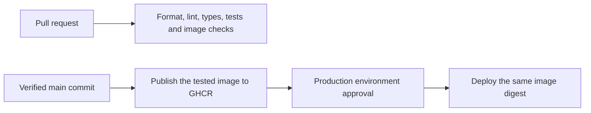

# Production delivery

This repository prepares delivery; it does not provision servers or enable GitHub deployments automatically. `HOSTING_ENABLED` is unset by default. No server, registry image, production secret or GitHub environment has been created by preparing these files.

This checkout targets `Treca-Raja/rajcord-public` and publishes only `ghcr.io/treca-raja/rajcord-public` images. GitHub repository names retain their configured case in policy checks; GHCR image names are lowercase. Production secrets, environment approvals, branch protection and package permissions must be configured and verified in this repository. The host-preparation evidence below was recorded for the predecessor repository; it does not confirm this repository's settings or grant its CI access to that host.

The recorded plan uses the user's existing AlphaVPS production server without a permanent staging environment and the Cloudflare-managed domain rajcord.com. The service templates support domain-based HTTPS/media identities and optional IP-only TLS. Historical preparation on 2026-10-27 for the predecessor repository verified host tools/firewalls, key-only SSH, DNS, independent production secrets, public certificates and encrypted R2 storage. That repository's production environment had main-only deployment and a maintainer reviewer, with delivery disabled. Application deployment, live database backup/recovery and active release maintenance jobs remained pending. Recheck the intended target and this repository's setup before delivery. See [dated verification](verification.md) for completed checks and remaining limits.

## Release path



Pull requests use read-only CI without deployment secrets. Linux integration/image checks and Windows unit tests/builds run in parallel; the required `verify` job fails if either job fails, is cancelled or is skipped. Linux runs the browser smoke against the runner's installed headless Edge with an explicit executable path. Windows compiles Electron but does not launch it. Native Windows notifications, actual audio devices and WAN voice still need separate verification.

After both jobs pass, enabled main runs transfer the exact tested image to a separate job with registry write permission. Production receives its immutable SHA-256 digest after the required environment approval; it never rebuilds the image. A commit label is checked before publishing. Workflow summaries show both check results, the published digest and successful deployment readiness. Main runs serialize without cancellation during deployment; an approval waiting on an old run must be rejected or completed before the next main run proceeds. Current-main checks reject superseded commits before publication and deployment. Keep pull requests small enough to review and reject outdated approvals promptly.

| Environment | Purpose                               | Data and access                                                                         | Delivery                                    |
| ----------- | ------------------------------------- | --------------------------------------------------------------------------------------- | ------------------------------------------- |
| Local       | Development                           | Existing loopback services and development accounts                                     | Existing pnpm commands                      |
| CI fixtures | Test builds and hosted service wiring | Disposable synthetic accounts, networks and tmpfs databases                             | Created and removed during CI               |
| Production  | The friends' actual community         | Existing AlphaVPS host, independent secrets, persistent database and off-server backups | Tested digest after the maintainer approves |

Do not copy production accounts, cookies or messages into test fixtures. One environment runs per host, enforced by `/etc/tricord/host-environment`. The helpers retain staging support for a possible future isolated host, but the pipeline does not create or deploy one. CI fixtures test service wiring without a second paid VPS. They cannot reproduce the production network or prove human voice quality; use a small initial production alpha and explicit post-deployment checks. No Kubernetes, managed database or multi-instance API is needed for this ten-person application.

## GitHub setup before enabling delivery

1. In `Treca-Raja/rajcord-public`, protect `main`: require a pull request and the `verify` status check; disallow force pushes and deletion. Require up-to-date checks, enforce the rule for administrators and bind the check to the GitHub Actions app. A sole maintainer can use zero required second-person PR reviews; require another reviewer if a second maintainer joins. Use a feature branch/PR for publishing these local changes, preserving protection. Protect workflows and operator scripts with the same care as application code.
2. Create the environment named exactly `production`. Restrict it to the selected branch `main`, with policy type **branch**, not tag.
3. In `production`, add this repository's maintainer as a required reviewer and disable administrator bypass. For a sole maintainer, allow self-review so the maintainer can approve their own run. The pipeline queries GitHub and fails closed if the reviewer, exact branch policy or an explicit disabled administrator-bypass setting is absent. Verify these settings by API readback before enabling delivery; predecessor-repository configuration does not carry over. Environment approval withholds production secrets until approved. See [GitHub's environment rules](https://docs.github.com/en/actions/reference/workflows-and-actions/deployments-and-environments).
4. In `production`, configure variables `DEPLOY_HOST` (the host's public IPv4 for SSH), `DEPLOY_HTTPS_HOST=rajcord.com` (required bare hostname for the external HTTPS readiness check), `DEPLOY_USER` and optional `DEPLOY_PORT` (default `22`). Add secrets `DEPLOY_SSH_KEY` and `DEPLOY_KNOWN_HOSTS`. Obtain the SSH host fingerprint through the provider console or another trusted channel. The pipeline never trusts an unverified `ssh-keyscan` result. For a custom SSH port, use the standard `[IP]:port` known-hosts entry.
5. Prepare and test the production host below. For the first image, keep `HOSTING_ENABLED=false` and dispatch `gh workflow run verify.yml --ref main -f publish_only=true`. This tests and publishes the exact current-main image while explicitly skipping both production jobs, even if delivery is enabled later. A normal dispatch leaves `publish_only=false`. New GHCR packages are private by default; then configure image access before enabling deployment. If GHCR remains private, install a read-only package credential in root's Docker credential store. Authenticate using `docker login --password-stdin` from a secure local prompt or protected file. CI's write token never travels to the host. Package visibility is a separate choice from public source visibility.
6. Set the **repository** variable `HOSTING_ENABLED=true` only when the host, secrets, backup target, domain configuration and approval rules are ready. Push a reviewed main change or dispatch `Verify` on `main`. Pull requests and non-main dispatches cannot publish or deploy.

GitHub settings are intentionally a separate setup step; adding YAML does not create protection rules or SSH credentials. Jobs run on GitHub-hosted Ubuntu and Windows runners; publication and deployment run on Ubuntu. Avoid a persistent self-hosted runner with access to production secrets for public pull requests.

## Host preparation

Inspect the existing AlphaVPS Linux x86-64 host before installing anything. It needs a stable public IPv4, Docker Engine with Compose **2.24.4 or newer**, `bash`, `curl`, `openssl`, `jq`, `flock` and `restic`. Initial configuration can use the pinned Node 24 container through initialize-runtime.sh; host Node installation is optional. Configure time synchronization and operating-system security updates. Reboots and Docker upgrades should be planned around calls.

For a reviewed fresh Ubuntu 24.04 x86-64 host, `scripts/hosting/prepare-host.sh` installs the official Docker apt packages and host tools, configures bounded default container logs, enables UFW and installs the Docker forwarding filter/startup hook. It does not remove conflicting existing packages, initialize a database or deploy the application. `scripts/hosting/firewall.sh` owns only TRICORD-INGRESS and its DOCKER-USER jump; it matches original destination ports so an accidental mapping such as 5432→8080 remains blocked. Allowed flows return to Docker's own rules, preserving network isolation. It handles the IPv6 Docker chain when present; IPv6 WAN behavior still needs its own verification before adding AAAA records.

After verifying an independent administrator SSH key login, `scripts/hosting/harden-ssh.sh` validates and reloads a key-only SSH drop-in. Root key login remains available; password and keyboard-interactive login are disabled. Use a temporary rollback timer and a fresh post-reload connection when applying this to a real host. The helper preserves an existing drop-in and refuses to reload a mismatched effective policy. It does not change the root password used by the provider console.

Create a dedicated SSH deployment user with its own key per environment. It needs write access to `/opt/tricord/releases` and passwordless `sudo` for the deployment script. A script able to run Docker is effectively privileged: this account and the trusted main workflow can administer the host. Do not reuse a personal SSH key, expose the Docker socket publicly, or give this access to pull-request jobs. Verify the provider firewall and SSH access before changing host firewall rules.

`scripts/hosting/configure-deploy-user.sh CI_PUBLIC_KEY_FILE` prepares tricord-deploy, preserves existing authorized keys and validates its sudoers entry. The CI private key belongs in the production GitHub environment, not on the VPS or in source. The administrator key and CI key must remain separate.

Allow these public service ports and deny other inbound traffic at the provider firewall:

| Port                                                        | Purpose                                                    |
| ----------------------------------------------------------- | ---------------------------------------------------------- |
| SSH TCP, restricted to trusted administration/runner access | Deployment and maintenance                                 |
| 80/TCP                                                      | ACME HTTP-01 validation and HTTPS redirect                 |
| 443/TCP                                                     | Tricord HTTPS, Socket.IO and authenticated voice signaling |
| 7881/TCP, 7882/UDP                                          | LiveKit direct media                                       |
| 3478/UDP, 5349/TCP                                          | Embedded TURN UDP and TLS                                  |
| 50000–50199/UDP                                             | Bounded embedded TURN relay range                          |

PostgreSQL 5432, API 3001 and LiveKit control 7880 have no published host port. Never deploy the development Compose files publicly. Docker-published ports can bypass ordinary UFW rules; use the provider firewall and inspect Docker's actual routing rather than assuming UFW protects a published port. See [Docker's firewall guidance](https://docs.docker.com/engine/network/packet-filtering-firewalls/).

The private frontend subnet is `172.30.241.0/28`, with proxy `.2` and app `.3`. Check it does not overlap existing host/VPN routes. If changing it, update the Compose addresses and generated `TRUST_PROXY_ADDRESS` together before the first deployment. The API trusts only that immediate peer; Nginx replaces forwarding headers with the real client address. Existing HTTP and socket budgets stay enabled.

On each host, place a reviewed, published commit's operator files in `/opt/tricord/releases/FULL_COMMIT_SHA`. CI normally transfers `scripts/hosting` and `infrastructure/hosting` there. The first bootstrap needs those files installed manually from the same reviewed commit. Do not put a Git working copy or secrets in the container image.

Generate the runtime files **on that host**, as root. Its parent directory must already exist. Replace the placeholders; the example IP must be the host's actual routable IPv4:

```bash
sudo install -d -m 700 /etc/tricord
sudo bash /opt/tricord/releases/FULL_COMMIT_SHA/scripts/hosting/initialize-runtime.sh production PUBLIC_IPV4 rajcord.com turn.rajcord.com
```

Initialization generates independent database and LiveKit secrets, root-only environment files, proxy configuration and environment/address markers. The public IPv4 remains the advertised RTC address; the optional web and TURN hostnames supply TLS identities and the trusted app origin. Omitting both hostnames retains IP-only HTTPS; omitting just TURN_HOST reuses the web hostname for TURN. It refuses an existing directory, including a symlink; reruns never rotate initialized credentials. Existing IP-only runtime directories retain their old identity unless deliberately migrated; do not reinitialize them to change a domain. Preserve the runtime directory in an encrypted operator backup separately from database snapshots. Never print `app.env`, `postgres.env`, `livekit.yaml`, `restic.env` or expanded `docker compose config` in CI/chat diagnostics.

The container helper takes both hostnames explicitly and reads its Node image pin from the server Dockerfile. Its source mount must contain the reviewed hosting files and Dockerfile, with runtime secrets outside that source directory. It refuses an existing /etc/tricord/production directory. The direct Node/pnpm initializer retains the optional-hostname interface described above. Initial host preparation can use a private bootstrap directory before a release commit is published; this is not a successful app release and must not be labeled with an unrelated commit SHA.

## HTTPS and media

For scoped Cloudflare API access instead of manual DNS editing, create a user API token from the **Edit zone DNS** template. Use Zone/DNS/Edit plus Zone/Zone/Read for zone lookup, restrict resources to the single zone rajcord.com, and set a short setup expiration. No account permissions or Global API Key are required. The DNS permission covers all DNS records in that zone; the authorized setup changes are only the app and TURN A records. See [Cloudflare's token instructions](https://developers.cloudflare.com/fundamentals/api/get-started/create-token/).

Keep the token out of chat, shell command arguments, source files and the VPS. On the operator's **Windows PC**, a hidden prompt can save it in user-encrypted local storage:

```powershell
Set-Location F:\tricord
New-Item -ItemType Directory -Force .local\cloudflare | Out-Null
Read-Host "Cloudflare API token" -AsSecureString |
    ConvertFrom-SecureString |
    Set-Content -LiteralPath .local\cloudflare\token.dpapi -Encoding ascii
```

This file is ignored by Git and excluded from the Docker build context. Without an explicit encryption key, Windows PowerShell uses [Windows DPAPI](https://learn.microsoft.com/en-us/powershell/module/microsoft.powershell.security/convertfrom-securestring) for this conversion. Read/decrypt it only in the operator Windows account when making the scoped API calls, assign the plaintext to a temporary variable, and never print it or HTTP authorization headers. Verify the token and inspect existing DNS before editing the two records; preserve unrelated records. The token is not required by HTTP-01 certificate renewal and can be revoked after DNS setup.

In Cloudflare DNS, point the `@` and `turn` A records to the VPS's public IPv4, with **DNS only** (grey cloud) for the initial deployment. The app will be served at https://rajcord.com and TURN at turn.rajcord.com. Do not add AAAA records until IPv6 has been configured and verified. Preserve unrelated mail/TXT records. The relay hostname must bypass Cloudflare's standard HTTP proxy; see [Cloudflare proxy status](https://developers.cloudflare.com/dns/proxy-status/). The hostnames must resolve to this server before the HTTP-01 challenge is attempted.

The initial certificate bootstrap serves only the ACME challenge. With port 80 reachable, run on the appropriate host:

```bash
sudo bash /opt/tricord/releases/FULL_COMMIT_SHA/scripts/hosting/bootstrap-tls.sh production ACME_CONTACT_EMAIL
```

For DNS identities, the helper requests one trusted certificate covering the configured web and TURN hostnames, stores it as cert name `tricord`, then stops the temporary proxy. It uses the shared webroot for HTTP-01, as described in [Certbot's webroot guide](https://eff-certbot.readthedocs.io/en/stable/using.html#webroot). For IP-only configuration it retains the short-lived public-IP profile. Let's Encrypt's untrusted **ACME staging CA** is separate from an application staging environment. For an ACME rehearsal use a disposable certificate directory so it cannot replace the trusted chain.

The contact-email argument is optional; omitting it registers without an email instead of inventing an address. Noninteractive certificate and migration containers explicitly disable stdin/TTY attachment so they cannot consume the remainder of an SSH operator script. A certificate renewal rehearsal can run against the ACME test service without replacing the trusted production chain; full application/TURN reload behavior still requires the deployed services.

The renewal timer runs twice daily, reloads Nginx and restarts LiveKit after a certificate changes, and retains a retry marker if service reload fails. TURN certificate restarts can briefly interrupt calls. Expiry below 48 hours fails the operational check. This also supports the IP-only fallback: [Let's Encrypt documents its six-day certificates and renewal/reload requirement](https://letsencrypt.org/2026/03/11/shorter-certs-certbot).

Embedded TURN/TLS uses **5349**, because HTTPS occupies 443 on this one-IP host. Networks allowing only TLS media on 443 may still fail. [LiveKit recommends TURN/TLS on 443 for that case](https://docs.livekit.io/transport/self-hosting/ports-firewall/). A separate relay IP or a deliberately tested multiplexing design is follow-up work if the friends' networks require it. Do not claim unrestricted-network compatibility from the prepared configuration. Public certificate issuance, the actual advertised ICE addresses and relay behavior still require real cross-network browser/Electron testing. Local operational checks verify the TURN certificate's configured DNS name/SNI or IP identity without disabling certificate trust checks.

## Off-server backups and first deployment

The VPS disk stores the live database and can hold local backups. A second copy outside the VPS protects against losing that server or disk; a local snapshot alone cannot do that. The user confirmed R2 was already enabled, created rajcord-production-backups with a requested bucket-scoped key and saved the credentials securely. The encrypted repository is initialized; its disposable upload/retrieval and full integrity check passed on 2026-10-27. No live database backup or post-migration recovery check has run yet. Keep the existing deployment backup gate enabled. DNS-only Cloudflare access is separate from R2 storage access and cannot create or administer an R2 bucket.

Use a private, encrypted **off-server** restic repository for each environment. The [R2 setup guide](backups.md) records the bucket settings, scoped-key handoff and a reference environment. The production repository and protected server files already exist; preserve them rather than repeating initialization. Credentials belong in root-owned `/etc/tricord/ENVIRONMENT/restic.env`, mode `600`. It is a root-managed shell environment file. Set `RESTIC_REPOSITORY`, `RESTIC_PASSWORD_FILE` and the backend's required credentials. Supported repository prefixes here are SFTP, HTTPS S3, B2, Azure or Google Storage. Verify the storage is genuinely outside the VPS; the prefix check cannot establish provider ownership. For SFTP configure a trusted SSH host key as well. Initialize a new repository only once with `restic init` under the same protected environment, and preserve its password separately. Do not put any backup credentials in GitHub Actions.

Each deployment:

1. Validates the environment, full commit directory, image digest and required configuration; acquires the environment lock.
2. Pulls images, starts PostgreSQL and stops the old app to quiesce writes.
3. Dumps the database and uploads the encrypted backup. A failed backup blocks migrations.
4. Runs the new image's additive migrations, starts app/voice/proxy, waits for application health and verifies private voice control and the TURN TLS listener/certificate.
5. Checks trusted HTTPS readiness locally; CI repeats the HTTPS check from outside the VPS.
6. Records the successful commit and image, then updates `/opt/tricord/ENVIRONMENT-current` for maintenance timers.

There is a short maintenance interruption, including active calls. This is a single API deployment, not a zero-downtime cluster. Failure leaves data intact and reports a failed deployment; it never resets a database or automatically rolls back schema. The previous successful marker remains available for diagnosis.

After the first successful deployment, initialize the owner using the built CLI in an interactive server terminal. With `TRICORD_ENVIRONMENT`, `TRICORD_CONFIG_DIR` and `TRICORD_IMAGE` exported from the chosen environment/recorded image, use the matching Compose file:

```bash
sudo -i
export TRICORD_ENVIRONMENT=production
export TRICORD_CONFIG_DIR=/etc/tricord/production
export TRICORD_IMAGE="$(cat "$TRICORD_CONFIG_DIR/image")"
cd /opt/tricord/production-current
docker compose -f infrastructure/hosting/compose.yaml run --rm --no-deps app node dist/auth/bootstrap.js
```

The CLI hides the password and refuses to reinitialize an existing owner. Keep disposable test accounts separate from the real production community.

Run a normal backup after migrations so the newest snapshot contains the initialized schema, then verify retrieval and restoration:

```bash
bash scripts/hosting/backup.sh production
bash scripts/hosting/restore-check.sh production
bash scripts/hosting/check.sh production
```

The restore check retrieves the latest environment-tagged off-server snapshot into a private temporary directory. It restores into a disposable PostgreSQL container with no network, no published ports and tmpfs storage, checks the migration journal and required tables, then removes only that fixture. It never restores over the live database. A successful schema check does not replace periodic operator checks of actual application recovery.

## Scheduled operations

After the first successful deployment and restore check, install the units from that release on the production host:

```bash
sudo install -m 644 infrastructure/hosting/systemd/tricord-*.service infrastructure/hosting/systemd/tricord-*.timer /etc/systemd/system/
sudo systemctl daemon-reload
sudo systemctl enable --now tricord-backup@production.timer tricord-renew@production.timer tricord-check@production.timer tricord-restore-check@production.timer
```

Backups run daily; retained snapshots cover seven daily, four weekly and six monthly periods for this environment. Restic pruning is separate operator maintenance; monitor remote storage and run `restic check`/`prune` with the proper repository when appropriate. Restore checks run weekly. Local dump files are private and removed after upload, including upload failure; interrupted jobs may require cleanup of their specifically named temporary directory.

Health checks run every 15 minutes and fail for unhealthy HTTPS/database access, unavailable private voice control or TURN TLS, a certificate below 48 hours, pending certificate reload, no backup within 25 hours, no successful restore check within eight days, or Docker disk usage at least 85%. Container logs rotate at three 10 MB files per service. Request URL logs are disabled at the proxy because voice URLs can include opaque lease credentials. The service checks create systemd/journal failures; **configure an external uptime check and an alert destination before inviting friends**. No alert delivery/account is provisioned here. Review `systemctl --failed`, timer status, Docker disk usage and backup retention regularly.

## Recovery and release acceptance

If deployment fails before migration, diagnose the configuration or backup target and restart the previously recorded app image if needed. After a migration, first determine whether the old app is compatible with the additive schema. If compatible, deploy the previous tested image with its reviewed operator files as an explicit rollback. The pipeline intentionally deploys only current main, so application rollbacks normally use a new reviewed revert commit, pass CI and retain the same production approval path. Never edit applied migration files.

Database restoration is a separate maintenance operation: stop application writes, take a fresh incident backup, restore a chosen off-server snapshot into a **new** database/volume, validate it with a compatible app image, then deliberately switch the application connection. Keep the old database intact until recovery is accepted. Restoring an older snapshot can lose messages written after it; never automate this as a response to a failed health check.

PostgreSQL major upgrades require a separate planned data migration and recovery rehearsal; do not change the pinned major version as an ordinary image rollout. Dependabot proposes routine Compose image updates while ignoring automatic major-version proposals.

Before production approval, inspect the CI results, candidate changes, backup readiness and any manual local browser/Electron checks warranted by the change. After deployment, verify registration/approval, login cookies, chat/DM/group privacy, unread progress and browser/Electron connectivity. For the initial alpha, test real voice with two or three people on separate networks before expanding to ten. Check direct UDP, TCP fallback, TURN use and reconnects with actual headsets. Ensure automated renewal, backup retrieval and external alerts have been exercised. With no separate staging host, actual production-network behavior is verified after deployment; local synthetic tests cannot certify these WAN checks.

## Local verification

```powershell
pnpm server:build
pnpm test:server-image
pnpm test:hosting
```

The hosted-stack smoke first exercises backup, migration and HTTPS failure handling with mocked operator commands in a networkless container without a Docker socket. It then generates disposable secrets and a self-signed fixture certificate, overrides all published media ports, exposes only a random loopback HTTPS port and replaces PostgreSQL storage with tmpfs. It verifies real TLS with that explicit fixture trust, migrations, proxy headers, secure cookies and private LiveKit control with the hosted TURN configuration. It creates no production certificate or persistent database volume and removes only its own Compose project. CI runs it before the tested image can be published. It does not execute SSH, restic against a real backend, systemd timers or public ACME issuance.
