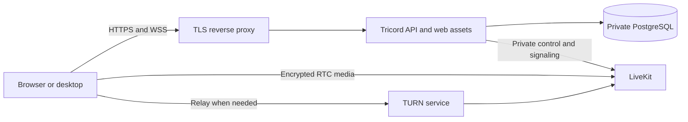

# Hosted alpha preparation

This repository is prepared for private GitHub storage and automated verification. The server image is tested locally. No cloud server, domain, TLS endpoint or internet-facing deployment has been provisioned yet.

## What is ready

- A multi-stage Linux image builds the existing application and runs only the API/web runtime as the non-root node user. Node base images and CI actions are pinned.
- Docker build context excludes Git history, local environments, artifacts, node_modules, backups and local desktop profiles. Runtime packages include built code and migrations.
- CI runs formatting, lint, TypeScript, unit tests, real PostgreSQL/LiveKit integration tests, the production build and the server-image smoke. It has read-only repository permissions and does not deploy.
- The image smoke uses an isolated Docker network, a PostgreSQL tmpfs and a separate LiveKit container. It verifies migrations twice, web assets, database readiness, registration/login, Secure/HttpOnly/SameSite cookies, pending-account restrictions, authenticated private LiveKit control, and an actual pg_dump/pg_restore round trip.
- Production voice configuration accepts the private Docker hostname livekit. Browser connections still pass through the authenticated Tricord signaling gateway; LiveKit bearer tokens remain internal.
- Hosted leases let LiveKit supply ICE/TURN configuration. Development leases retain an empty ICE-server list and loopback-only configuration.
- Desktop can load an operator-configured exact HTTPS origin. Its microphone permissions, navigation restrictions and renderer isolation use that same trusted origin. Temporary-cookie cleanup is scoped to the selected server.

## Local image verification

Docker Desktop must be running:

```powershell
Set-Location F:\tricord
pnpm server:build
pnpm test:server-image
```

The smoke creates random test credentials and a temporary environment directory. It publishes only the disposable API port on 127.0.0.1, and cleans up its own containers/network/files. PostgreSQL uses tmpfs, so no Docker volume is created or removed. Real development accounts, credentials and volumes are untouched. This test exercises production application settings over local HTTP with an explicit HTTPS Origin header; it does not certify a public TLS endpoint or WAN media routing.

## Proposed first deployment

Use one Linux x86-64 VPS near the group, with an initial private alpha for two or three friends. A Germany region is a reasonable first candidate for a group mostly in Europe; actual latency and voice stability must be measured.



Only the reverse proxy and required media/relay ports should be public. PostgreSQL, the API's direct port and LiveKit control must remain on the private container network. Do not deploy the development Compose files unchanged.

Production API configuration will supply NODE_ENV=production, WEB_ORIGINS=https://the-chosen-domain, DATABASE_URL for the private postgres service, and LIVEKIT_URL=http://livekit:7880 with freshly generated API credentials. Production never loads the workstation's infrastructure/.env.voice. Do not reuse development passwords or commit generated configuration.

After the server exists, desktop can target it with:

```powershell
$env:TRICORD_SERVER_URL = "https://your-chosen-domain"
pnpm --filter @tricord/desktop start
```

Use the built desktop command for this; dev:desktop deliberately continues to use the local development origin.

## Required before inviting friends

1. Choose the monthly budget, cloud account/region and domain name; review the actual recurring cost.
2. Provision the server and SSH access, with an explicit deployment firewall.
3. Configure DNS, a trusted TLS reverse proxy, public RTC addressing and TURN/TLS fallback. Keep LiveKit control behind the existing authorization gateway.
4. Generate separate production secrets and initialize the production owner locally on the server.
5. Schedule PostgreSQL dumps to private storage outside the VPS, define retention, and test restoration there. The local image smoke proves dump compatibility, not off-site backup automation.
6. Configure restart policies, disk monitoring, log rotation and the update/rollback procedure.
7. Test HTTPS cookies, desktop connectivity, unauthorized media access and real voice between separate networks. Then expand from two or three users to ten.

No hosting purchase or deployment is performed by the CI workflow. Server/domain choices and access are still required to finish these steps.

## Repository publication review

Before the first GitHub upload, seven existing commits and 182 unique historical file blobs were checked for tracked environment/profile files, configured database/LiveKit secret values, private keys and high-confidence credential patterns. No matches were found. This is a scoped review, not a guarantee that arbitrary historical secrets can be detected.

The private repository preserves existing Git history. Local environment files and generated credentials stay on the workstation. Do not make the repository public or add collaborators without an explicit decision.
