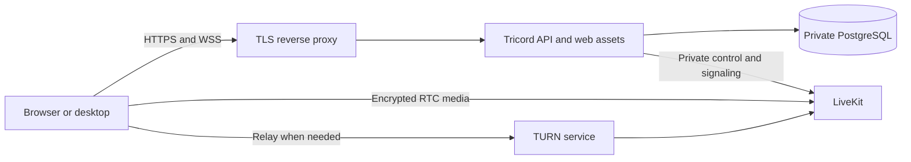

# Hosted alpha preparation

The active source repository is public at [fakebane/tricord-public](https://github.com/fakebane/tricord-public), with automated verification. The previous private repository is retained as an archived predecessor. The server image is tested locally. The existing AlphaVPS VPS has host tools/firewalls, key-only SSH, production runtime secrets and public certificates prepared for the Cloudflare-managed domain rajcord.com. No application deployment has occurred and public HTTPS is not currently serving the app. The plan omits permanent staging and uses disposable CI tests before approval-gated production delivery.

The [production delivery runbook](deployment.md) supplies service configuration, CI/CD setup, pre-migration backups, certificate renewal and operational jobs. GitHub's production environment now has the main-only policy, maintainer reviewer and separate deployment credentials, while HOSTING_ENABLED remains false. Administrator bypass is disabled and verified by API readback; release policy fails closed if its status is missing. DNS, public certificate issuance and a renewal rehearsal are verified. The encrypted R2 repository is initialized and its storage round trip/integrity check passed; live database backup/recovery, source publication, app deployment, active maintenance jobs and WAN voice remain outstanding.

## What is ready

- A multi-stage Linux image builds the existing application and runs only the API/web runtime as the non-root node user. Node base images and CI actions are pinned.
- Docker build context excludes Git history, local environments, artifacts, node_modules, backups and local desktop profiles. Runtime packages include built code and migrations.
- CI runs formatting, lint, TypeScript, unit tests, real PostgreSQL/LiveKit integration tests, the production build, workflow/shell validation and both image/hosted-stack smokes. Pull requests have read-only repository permissions. Enabled trusted main runs publish the tested image by digest and await production approval before deploying that same digest.
- The image smoke uses an isolated Docker network, a PostgreSQL tmpfs and a separate LiveKit container. It verifies migrations twice, web assets, database readiness, registration/login, Secure/HttpOnly/SameSite cookies, pending-account restrictions, authenticated private LiveKit control, and an actual pg_dump/pg_restore round trip.
- Production voice configuration accepts the private Docker hostname livekit. Browser connections still pass through the authenticated Tricord signaling gateway; LiveKit bearer tokens remain internal.
- Hosted leases let LiveKit supply ICE/TURN configuration. Development leases retain an empty ICE-server list and loopback-only configuration.
- Unpackaged desktop can load an operator-configured exact HTTPS origin. Installed Rajcord is pinned to `https://rajcord.com`; see [desktop distribution](desktop-distribution.md). Its microphone permissions, navigation restrictions and renderer isolation use that same trusted origin. Temporary-cookie cleanup is scoped to the selected server.

## Local image verification

Docker Desktop must be running:

```powershell
Set-Location F:\tricord
pnpm server:build
pnpm test:server-image
```

The smoke creates random test credentials and a temporary environment directory. It publishes only the disposable API port on 127.0.0.1, and cleans up its own containers/network/files. PostgreSQL uses tmpfs, so no Docker volume is created or removed. Real development accounts, credentials and volumes are untouched. This test exercises production application settings over local HTTP with an explicit HTTPS Origin header; it does not certify a public TLS endpoint or WAN media routing.

## Proposed first deployment

Use the existing AlphaVPS production VPS, starting with an alpha for two or three friends. Initial inspection on 2026-10-27 confirmed Ubuntu 24.04.2 x86-64, two CPUs, approximately 4 GB RAM, 1 GB swap and 35 GB free disk space. Host preparation subsequently installed Docker/Compose, restic and security tools, enabled host/Docker firewall rules, disabled SSH password login and configured a separate deployment account. No second server is required. Measure latency, memory, CPU and voice stability before expanding to ten participants.



Only the reverse proxy and required media/relay ports should be public. PostgreSQL, the API's direct port and LiveKit control must remain on the private container network. Do not deploy the development Compose files unchanged.

Domain initialization supplies NODE_ENV=production, WEB_ORIGINS=https://rajcord.com, DATABASE_URL for the private postgres service, and LIVEKIT_URL=http://livekit:7880 with freshly generated API credentials. Optional web/relay hostname arguments select rajcord.com and turn.rajcord.com, while the supplied public IPv4 remains the RTC node address. Production never loads the workstation's infrastructure/.env.voice. Do not reuse development passwords or commit generated configuration.

After the domain deployment has been verified, desktop can target it with:

```powershell
$env:TRICORD_SERVER_URL = "https://rajcord.com"
pnpm --filter @tricord/desktop start
```

Use the built desktop command for this; dev:desktop deliberately continues to use the local development origin.

## Required before inviting friends

1. Verify the existing VPS's host identity, operating system, resources, services and storage without disturbing existing data.
2. Establish SSH key access and an explicit deployment firewall.
3. Adapt and verify domain-based HTTPS, certificate renewal with service reload and expiry monitoring, DNS, public RTC addressing and TURN/TLS fallback. Keep LiveKit control behind the existing authorization gateway.
4. Generate separate production secrets and initialize the production owner locally on the server.
5. Schedule PostgreSQL dumps to private storage outside the VPS, define retention, and test restoration there. The local image smoke proves dump compatibility, not off-site backup automation.
6. Configure restart policies, disk monitoring, log rotation and the update/rollback procedure.
7. Test HTTPS cookies, desktop connectivity, unauthorized media access and real voice between separate networks. Then expand from two or three users to ten.

The workflow does not purchase hosting. Its deployment jobs remain disabled until explicitly enabled and configured. Verified SSH access, domain/DNS configuration, a backup destination and the production GitHub environment are still required to finish these steps.

## Existing host and domain

On 2026-10-27 the user supplied the existing domain and AlphaVPS C4G VPS, then preferred omitting a permanent staging environment. This supersedes the earlier no-domain/two-host proposal. Start with the existing resources and free automatically renewed certificates. A change of hosting plan or additional paid storage must have a concrete cost and authorization before purchase.

The advertised resources do not establish ten-person capacity. Validate two or three remote participants first, then ten; monitor CPU, memory, audio loss/jitter, reconnects and API responsiveness. Preserve audio quality and user capacity rather than reducing them to fit an undersized server. CI service fixtures cannot establish the VPS's WAN capacity.

The local fixture verifies DNS identities for HTTPS and TURN TLS, including SNI, while the image smoke retains IP-origin application coverage. Cloudflare DNS, real public certificate issuance and an ACME renewal rehearsal now pass. Service reloads, off-server recovery, monitoring and WAN relay behavior still need validation before users depend on the app.

## Repository publication review

Before the first GitHub upload, seven existing commits and 182 unique historical file blobs were checked for tracked environment/profile files, configured database/LiveKit secret values, private keys and high-confidence credential patterns. No matches were found. This is a scoped review, not a guarantee that arbitrary historical secrets can be detected.

At the user's request, the active project moved to a new public repository with its existing Git history. Before publication, all nine preceding commits and 202 historical file versions were checked again for the configured database/LiveKit secret values, private runtime paths, private keys and high-confidence credential patterns; no matches were found. Commit email addresses use GitHub's noreply format. The predecessor remains private and archived. Local environment files and generated credentials stay on the workstation.
