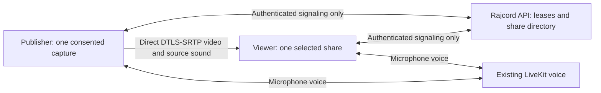

# Screen sharing: implementation design

Status: proposed implementation, not a shipped feature or performance certification. Prepared 2026-10-29 against `develop` at `264fcc7`. Local branch: `feature/screen-share-design`. [Source ticket](https://trello.com/c/FGdnrVhK) remains the epic; it was read, not edited. [Visual concept](screen-sharing-concept.svg) uses fictional participants and illustrative status values.

For a new contributor or GPT session, use the [handoff entry point](screen-sharing-handoff.md). It identifies the current next slice, dated evidence and upstream drift; older checkpoint instructions below remain historical.

## Outcome and latest direction

Build direct, encrypted WebRTC screen video and source sound between approved participants in the same current voice channel. Keep voice on LiveKit. One captured source per account, up to ten publishers, one selected remote share per viewer, and up to nine viewers per publisher. Sharing and watching are independent.

The user's latest direction takes precedence over the ticket's delivery order: **working 1920 × 1080 at 60 fps and selectable bitrate are the first priority**. Deliver and qualify that milestone before spending time optimizing Ultra. Retain Low 480p/15, Auto starting at 720p/30, High 1080p/30, and add Smooth 1080p/60. Ultra 3840 × 2160/60 remains later work required to close the original epic; shipping the first milestone does not satisfy its AC12.

Confirmed visibility behavior: hiding/minimizing Rajcord stops incoming screen delivery, including its sound, while outgoing sharing continues. Returning restores the previously selected share only if its identity and authorization are still current. Outgoing sharing retains an indicator and Stop action, including the installed app's tray menu. Voice keeps its current behavior.

No server screen forwarding, TURN relay, recording, cameras, remote control, new database tables, purchases, public infrastructure changes or deployment in this design. The [server fallback ticket](https://trello.com/c/e7PiHdfg) remains separate. Do not introduce a general media framework or rewrite voice.

## Evidence and integration boundaries

| Current source                                                                                                                                  | Verified behavior                                                                                                   | Required seam                                                                                         |
| ----------------------------------------------------------------------------------------------------------------------------------------------- | ------------------------------------------------------------------------------------------------------------------- | ----------------------------------------------------------------------------------------------------- |
| [Voice service](../apps/api/src/voice/service.ts)                                                                                               | One session-bound lease/account; ten/channel; 45-second expiry; serialized joins; microphone-only JWT               | Authorize both screen peers using the existing leases; notify sharing on lease invalidation           |
| [Voice gateway](../apps/api/src/voice/gateway.ts)                                                                                               | `/media/rtc` authenticates opaque leases; LiveKit JWTs stay server-side                                             | Leave media source grants and gateway routing unchanged                                               |
| [API application](../apps/api/src/app.ts)                                                                                                       | Socket cookie/CSRF/origin checks; 16,384-byte transport limit; one-second voice sweep; fail-closed database outages | Register screen signaling and revoke screen resources on every lease-invalidating path                |
| [Chat transport](../apps/api/src/chat/transport.ts)                                                                                             | Live per-delivery checks; separate 60/minute messaging-event budget                                                 | Reuse auth patterns, not chat's rate budget or conversation rooms                                     |
| [Voice controller](../apps/web/src/voice-controller.ts)                                                                                         | Private lease; 10-second heartbeat; generation fences; exact audio devices; deafen; automatic lease recovery        | Expose a narrow in-memory session/lifecycle subscription, not mutable controller internals            |
| [Voice panel](../apps/web/src/VoicePanel.tsx), [app shell](../apps/web/src/App.tsx)                                                             | Controller currently belongs to the sidebar component                                                               | Lift ownership once into a call provider shared by sidebar and screen stage                           |
| [Desktop main](../apps/desktop/src/main.ts), [permissions](../apps/desktop/src/media-permissions.ts), [preload](../apps/desktop/src/preload.ts) | Audio-only permissions; sandbox; isolated context; installed close-to-tray; background throttling disabled          | Separate, gesture-bound display permission and picker lifecycle; keep camera denied                   |
| [Voice harness](../apps/api/src/voice/browser-harness.ts), [load harness](../apps/api/src/voice/load-smoke.ts)                                  | Disposable sessions/database/room prefix; synthetic microphone; autoplay bypass                                     | Reuse fixture lifecycle; add actual screen/video/audio checks and separate real-picker/autoplay tests |

The manifest pins Electron 45.0.0; web uses LiveKit client `^2.23.0` and Socket.IO `^4.8.1`. Read the lockfile and running versions in the first implementation task; a manifest range is not a tested runtime version. API/web ship in one image. This design keeps the current single-API-process assumption.

## Interaction and visual concept

Retain the current charcoal surfaces, green accent, Segoe UI, sidebar and text-channel navigation. Screen viewing occupies the main content stage, rather than squeezing video into audio settings. Keep the selected conversation mounted or preserve its scroll/read state explicitly; a covered or unfocused chat must not acknowledge unread messages.

**Sidebar:** connected channel, participant rows and a textual “Sharing” badge. A compact “Screens · 3” list contains names, sound availability and Watch buttons. No remote thumbnails: even a thumbnail would require receiving an unselected screen. Your own row says “You · Sharing”; local preview is separate. Channel entries outside the joined channel do not reveal a screen directory. The existing audio controls remain reachable.

**Watching stage:** header “Watching Morgan”, Direct status, actual received resolution/FPS, sound state, and Close. The picture uses contain/letterboxing, never misleading stretching or upscaling claims. Footer has requested quality, video bitrate cap, stream volume/mute, fullscreen and diagnostics disclosure. Display “Requested 1080p/60 · Receiving 1080p/43 · Network limited” when degraded. Before sufficient samples exist show “Measuring”, not 60 fps. Fullscreen affects layout only; no extra subscription or detached window in the first release.

**Outgoing strip:** always visible while sharing: “You are sharing”, local-only source label, sound mode, viewer count, selected ceiling, per-viewer bitrate cap and Stop sharing. Estimated aggregate upload is visible beside the cap. Example arithmetic, not a benchmark: nine viewers capped at 8 Mb/s video can require up to 72 Mb/s video upload, plus audio, transport and retransmission overhead. Actual traffic may be lower. A small muted local preview can be expanded. Stop is never blocked by an unrelated pending action.

**Start flow:** open settings from a user gesture; explain direct peers' IP visibility before first direct use; select quality and sound intent; invoke the platform chooser from an explicit button without an intervening network await. Browser uses its own chooser. Desktop uses the scoped chooser below. Returned capture stays local for preview and verification. “Start sharing” advertises only after the user confirms the exact source and audio mode. Cancellation closes all returned tracks. The preview is silent, and stopping/canceling a preview never creates a share advertisement.

“Include source sound” starts unchecked. Starting requires an explicit sound choice: include supported sound, or “Share video only”. If requested audio is absent, keep the source local and explain “No source audio was provided. Choose another source or explicitly share video only.” Never substitute the microphone. Do not infer audible sound from track existence: silence may be legitimate, so show input activity without blocking normal silence; qualification uses a known audible test signal.

**Change source:** Stop the old share first, then choose and preview a new source. Explain that viewers must choose the new share again. Cancel leaves sharing stopped. This avoids accidentally broadcasting a replacement to people who selected the old source. Changing quality/bitrate within the same live source does not require a new chooser. A source change initiated by browser capture controls must be detected and treated as a new consent boundary where supported; request surface switching off, and qualify the actual browser behavior rather than claiming constraints enforce security.

**Hidden/minimized:** close the receiving connection and detach its video/audio, remember only selected share ID and preferences. On return, reauthorize before reconnecting; do not auto-select a replacement publisher. Closing the stage clears that remembered selection. Outgoing capture and authorized outgoing links continue; tray status says “Screen sharing active” and offers “Stop sharing” and “Show Rajcord”. Do not put source names or participant names in OS notifications. Browser users retain the browser's own capture indicator.

**Accessibility:** labelled controls; keyboard source selection; dialog focus trap and restoration; Escape cancels picker/preview; visible focus; status/error announcements; source state expressed with text as well as color. Keep Stop outside transient dialogs. At narrow desktop widths, collapse the member rail and move chat behind a tab; do not hide Stop or audio controls. Mobile certification remains out of scope.

| Condition                   | User-facing result and action                                                                            |
| --------------------------- | -------------------------------------------------------------------------------------------------------- |
| Not in voice                | “Join a voice channel to share or watch.”                                                                |
| No watchers                 | “Sharing · No viewers”; local capture/preview may continue, no outgoing screen RTP                       |
| Direct ICE fails            | “Could not connect directly. Retry or check network restrictions.” No false Live state or hidden relay   |
| Selected source ends        | Stop all outgoing tracks/links; “Shared source closed. Choose a source to share again.”                  |
| Requested sound unsupported | Explain the exact sound scope before Start; offer supported choice or explicit video-only                |
| Output device disappears    | Pause receiving picture/sound and show “Choose speakers”; never play through the default output          |
| Autoplay denied             | “Enable screen playback” action; preserve selected output and volume                                     |
| Authorization lost          | Stop affected capture and links; “Screen sharing ended. Rejoin voice to start again.”                    |
| Encoder/quality unavailable | Keep voice alive; report the failing profile and offer an explicitly selected lower profile              |
| Source sound track ends     | Stop the share and explain sound ended; allow a new explicit video-only share, never silent continuation |

## Capture and source sound

Implement a small web capture adapter and a desktop adapter with the same result: one video track, zero or one consented source-audio track, local display label, sound scope, and a disposer. No capture titles, source IDs, thumbnails or track labels enter API metadata. Track IDs needed for peer negotiation are not source titles.

Browser capture requires transient activation; chooser constraints do not grant an exact source or persistent consent. Verify returned settings and audio tracks after selection. Use native source choice and a second local preview confirmation. See the [screen capture specification](https://www.w3.org/TR/screen-capture/).

For Electron, `setDisplayMediaRequestHandler` supplies requesting frame/origin/gesture information, and `desktopCapturer` enumerates sources. The documented Windows loopback option captures system audio. These APIs are building blocks, not a safe picker by themselves. See [Electron session](https://www.electronjs.org/docs/latest/api/session#sessetdisplaymediarequesthandlerhandler-opts) and [desktopCapturer](https://www.electronjs.org/docs/latest/api/desktop-capturer).

Proposed desktop flow: the gesture-triggered display request opens one trusted local picker owned by main. It gets ephemeral source summaries through a picker-only preload; main retains the actual source objects. Source selection returns a one-use opaque picker handle, not an arbitrary source ID from the remote renderer. Bind the pending request to the original WebContents, exact main frame, configured origin, request identity and navigation generation. Recheck all bindings when resolving the selection. Deny on cancellation, timeout, navigation, destroyed frame, logout or stale handle; invoke the callback exactly once. Enumerate again if the source vanished; never choose the first available source. Destroy picker data on exit. Do not expose a general desktop enumeration IPC to the remote app. New local picker assets must be packaged and smoke-tested with their own restrictive navigation/CSP.

The existing permission check/request handlers need a separate narrowly scoped `display-capture` path; do not simply allow `media: video`. Keep the microphone prompt and camera denial independent. Update the existing microphone prompt's “screen capture disabled” copy only when the feature actually exists. Narrow `tricordDesktop` additions cover capture cancellation, visibility/Stop events and indicator state, with explicit unsubscribe functions and trusted sender validation. Main owns capture permission; renderer owns media tracks and peer cleanup.

| Initial target                            | Required verification                                     | Sound wording                                                |
| ----------------------------------------- | --------------------------------------------------------- | ------------------------------------------------------------ |
| Windows 11 + pinned Electron, display     | Moving 1080p60 and audible system audio with voice active | “System sound — other applications may be audible”           |
| Windows 11 + tested Edge, browser tab     | Moving 1080p60 and audible selected-tab audio             | “Tab sound” only when actually supplied                      |
| Electron window / other Edge source types | Exact video; test supported audio combinations            | Never label whole-system loopback “this application's sound” |

**Audio feedback is a release gate.** Test whether system loopback captures Rajcord's received voice and screen sound. Headphones alone do not prevent digital loopback. Qualify a documented routing arrangement that keeps call playback out of the captured output, or a verified platform exclusion mechanism. Do not silently change the user's speaker device or mute voice to make the test pass. If the pinned APIs cannot provide a usable supported route, record the blocker and propose a separately scoped native capture change; do not promise app-only isolation or discard the desktop system-audio requirement. Edge selected-tab audio provides an independent required path, not a waiver for desktop.

## Direct connection architecture



Use one unidirectional `RTCPeerConnection` per active publisher/viewer relationship. Publisher offers `sendonly` video and optional source audio; viewer answers `recvonly`. The same capture tracks feed separate senders; do not clone/apply constraints per viewer and assume capture or encoder independence. No screen data channel or LiveKit screen publication. If two people watch each other, use two independent directional connections; this avoids negotiation roles changing under source switches.

The publisher is the only offerer. A server-created link has an epoch and monotonic negotiation sequence. Queue bounded early ICE until its remote description exists; associate candidates with that negotiation/ICE generation; reject old or unexpected descriptions. Serialize offer creation and sender parameter updates. Quality changes normally use sender parameters; if codec renegotiation is necessary, publisher remains the offerer. Do not send candidates to every channel member.

At most ten selected directed links exist channel-wide because each of ten people watches at most one other share; a publisher has at most nine outgoing and one incoming connection. This is not a 90-stream full mesh. Nevertheless one-to-nine fan-out can require nine encoders and nine copies of the media. Shared capture does not prove encoder reuse.

Use a separate screen ICE configuration, never copy LiveKit TURN servers. Empty ICE server configuration is suitable for local feasibility tests only. WAN needs an operator-approved STUN endpoint/policy; no third-party hostname is silently installed. Reject TURN URLs and relay candidates in supported clients and signaling validation; inspect the selected candidate pair to prove direct delivery. Private/local host candidates must remain usable for LAN tests. Do not persist raw candidates or SDP: they contain network/device information. Server authentication protects signaling, but a modified peer can still lie about its media or routing.

## Authorization and signaling contract

Add `apps/api/src/screen/{service,transport}.ts` and a dedicated shared contract module exported by `packages/shared/src/index.ts`. Reuse the current authenticated Socket.IO connection and its origin/cookie/CSRF boundary. Register separate `screen:*` events with their own bounded budgets; leave chat budgets and the 16 KB transport ceiling unchanged. Keep raw screen envelopes below that ceiling. No database migration.

In-memory state consists of: one bound controller transport per voice lease; one share per publishing lease; one selected share per watching lease; directional link records tied to both lease IDs and both bound transports. Server assigns share/link IDs. The client may send its own lease ID only to bind; the server derives account, session and channel. IDs are references, never bearer authority. A second tab cannot take over an active binding; orderly disconnect/rebind requires the same current lease and invalidates old transport epochs.

Every command validates shape/size and authenticates the caller again. Advertise, select, signal, renew and outgoing directory/link delivery require current approved sessions and non-revoked, unexpired same-channel leases. Signal relay checks both peers again immediately before delivery, including after asynchronous database work. Use existing voice serialization for lease-sensitive commits, with a consistent lock order; do not hold it while awaiting client acknowledgements. Bind cleanup to exact lease/transport identities so late disconnects cannot delete their replacements.

| Proposed event                                     | Request / response purpose                                                                                                                      |
| -------------------------------------------------- | ----------------------------------------------------------------------------------------------------------------------------------------------- |
| `screen:bind`                                      | Own `leaseId`, protocol version, request ID; returns transport epoch and own remaining lifetime; an authorized directory event follows          |
| `screen:publish`                                   | Idempotent request ID, source generation, profile/cap, consented sound mode; returns server `shareId`; never source name                        |
| `screen:stop`                                      | Own share ID; idempotent removal plus closing links                                                                                             |
| `screen:select`                                    | Share ID or null, selection revision, requested profile/cap; atomically removes old selection before creating a fresh `linkId`                  |
| Newer `screen:select` revision                     | Changes requested profile/cap through a fresh link; a separate in-place sender quality command is deferred to S3                                |
| `screen:signal`                                    | Link ID, transport epoch, negotiation revision, sequence, discriminated offer/answer/ICE payload; only authorized opposite endpoint receives it |
| `screen:renew`                                     | Current epoch, request ID and renewal revision; checks active link peers and returns remaining lifetimes without extending voice leases         |
| `screen:directory`, `screen:link`, `screen:closed` | Authorized server updates with revision/epoch and safe reason codes; clients ignore stale updates                                               |

Use discriminated success/error acknowledgements with safe codes (`not_authorized`, `stale`, `capacity`, `invalid`, `throttled`, `unavailable`) and optional retry delay. Missing/invalid acknowledgements time out; they never imply success. Bound idempotency/replay storage per live lease and clear on lease removal. Duplicate identical requests return the same result; reuse with different payload fails. On reconnect rebuild from a fresh authorized snapshot, not queued Socket.IO emits from the old connection. Do not buffer screen commands while disconnected.

A successful screen renewal cannot prolong either voice lease. Link expiry is no later than the minimum of both current voice-lease expirations. Return remaining duration; clients subtract the entire measured request round trip before starting a monotonic watchdog, and accept renewal only for the still-current request/epoch. A late or replayed response cannot reset a deadline. Existing 10-second voice heartbeats can trigger screen renewal after success; also renew a watch-only client. Do not call a peer-to-peer message proof of authorization.

On screen socket loss, official clients close media links immediately, while a still-live local capture can remain in a reconnecting state only until its existing authorization deadline. Same-lease recovery can re-advertise that unchanged capture under a new share identity and reauthorize interested viewers explicitly. New voice lease, expired deadline, logout, suspension, source end or quit stops capture; no automatic recapture. This differs deliberately from voice's ability to acquire a new lease automatically.

Add a synchronous lease-invalidated notification before awaiting LiveKit removal, and handle the app's database-failure path, which currently marks leases revoked directly. Revoke sharing on the existing one-second sweep, auth mutation reconciliation, socket binding loss and shutdown. Never overwrite `lease.close`, which belongs to the voice gateway. Reject renewals during database failure. One cleanup helper must close owned peer connections, stop owned capture, detach media, cancel timers/picker, invalidate generations, and remove directory/link state as appropriate.

The server cannot physically sever media between modified/colluding direct clients. The deadline is a supported-client obligation, not server-enforced P2P secrecy. Test hidden windows, sleep/resume and delayed timers; check deadlines before every resumed operation. Browser/OS suspension behavior is a qualification risk: do not claim a hard 45-second wall-clock cutoff on an untested runtime merely because a JavaScript timer exists.

### Initial protocol limits to validate

These are proposed engineering limits for tests, not approved performance budgets: 12 KiB SDP, 2 KiB single candidate, 32 buffered early candidates/link, two media sections, no data section, 128 candidates/negotiation, one pending negotiation/link. Keep the encoded event below 16 KiB and test real supported SDP before freezing the schema. Reject oversize input; do not add unbounded chunk assembly.

Prototype per-lease token buckets: control 60/minute with burst 10; signaling 120 events/second with burst 180 plus 256 KiB/second with 512 KiB burst; renewals separate at 12/minute with burst 3. Enforce an aggregate service ceiling and bound pending authorization work as well as bytes, so many individually valid events cannot exhaust database/API work. Measure nine-link ICE bursts and ten clients behind one IP; tune based on evidence, not by disabling limits. Coalesce candidate batches only within the envelope limit. Check budgets before expensive authorization; still recheck authorization for accepted events. A throttled screen link must not disconnect chat or voice.

## Quality, bitrate and adaptation

| Profile | Capture/send ceiling            | Role                                                            |
| ------- | ------------------------------- | --------------------------------------------------------------- |
| Low     | Fit within 854 × 480, 15 fps    | Economical viewer choice                                        |
| Auto    | Start within 1280 × 720, 30 fps | Default; adapt down and recover only up to this profile ceiling |
| High    | Fit within 1920 × 1080, 30 fps  | Ticket's original high profile                                  |
| Smooth  | Fit within 1920 × 1080, 60 fps  | First priority; qualify moving 1080p60                          |
| Ultra   | Fit within 3840 × 2160, 60 fps  | Later qualification; original epic remains open until proven    |

Preserve aspect ratio and use source-native dimensions when smaller; never upscale to satisfy a label. Sender chooses the maximum profile for its single capture. Viewer chooses within it. Increasing capture ceiling is applied only to the same authorized live source; failure leaves a truthful prior ceiling or stops the failed share. Reducing one viewer's quality must not call `applyConstraints` on the shared source.

**Bitrate is a separate control**, labelled “Video cap per viewer” for sender and “Video cap” for receiver. Proposed initial manual menu: 2, 4, 6, 8, 12 and 20 Mb/s plus Auto. This is an initial experiment range, not a claim that any value delivers 1080p60 or 4K60. Auto's per-profile caps and later Ultra range must come from feasibility measurements. Do not choose a production default by guessing. Persist only ordinary preferences, not capture permissions, source identifiers or authentication.

For each link, effective video cap is the minimum of publisher cap, viewer cap, qualified profile cap and adaptive network/CPU allocation. Show requested and effective values; never silently present an 8 Mb/s request as an 8 Mb/s measurement. Bitrate is a ceiling, not constant throughput. Source-audio bitrate is budgeted separately; sound should not silently disappear when video adapts. Receiver changes affect only that connection. Publisher cap reductions clamp all affected links and announce the limit to viewers.

Use each sender's fresh `getParameters()` then serialized `setParameters()` with `maxBitrate`, `maxFramerate` and `scaleResolutionDownBy`. Treat capability reports as hints and catch unsupported operations explicitly. Prefer negotiated, measured hardware-friendly codecs; compare H.264 and VP8 first, and investigate VP9/AV1 only if needed for measured quality/cost. Do not assume a codec name proves hardware acceleration or sustained 60 fps. See the [WebRTC encoding specification](https://www.w3.org/TR/webrtc/#rtcrtpencodingparameters).

Adapt per link based on actual encoded/received frames, congestion and loss; also enforce a publisher-wide resource/upload budget to protect voice. Define hysteresis from traces before shipping: downshift promptly on sustained overload and recover gradually, without repeated renegotiation. Show CPU/network/source limitations distinctly when known. Low should reduce that viewer's actual bytes on identical changing content; it must not lower another viewer's requested quality. Shared CPU/network overload may still degrade other delivery and must be reported honestly.

At zero viewers there are no sender connections and no screen RTP/audio traffic. Retaining local capture avoids repeated consent; preview can render less frequently while hidden. Stopping a connection must not stop the shared capture track while other viewers use it. No remote preview subscription, hidden audio-only subscription, or keepalive video.

## Playback and lifecycle implementation

Use one receiving video element with the corresponding stream's video and audio for normal A/V synchronization. Start muted and paused. Apply the exact selected sink before unmuting/playing; fence every asynchronous completion against link generation and output revision. Reuse a small extracted exact-output helper from the existing voice pattern only if both call sites benefit; keep stream volume independent from participant voice volume. Local preview is always muted.

Microphone mute affects microphone only. Stream mute/volume affects selected screen playback only. Deafen silences incoming voice and screen audio and retains preferences; outgoing source sound continues because deafen is not source-sound consent revocation. Turning source sound off removes/stops its outgoing audio; turning it back on requires a fresh consented capture if its track was stopped. Missing speakers pause receiving playback and require explicit replacement. Test switching outputs during a pending `setSinkId`/`play` completion.

The implemented `CallProvider` owns one VoiceController for the verified approved-session lifetime. Sidebar/view mounts subscribe to copied state and narrow audio controls; their unmount does not dispose the call. Logout intent triggers local cleanup immediately, before its HTTP response or React unmount. Screen code does not inspect private LiveKit rooms or read cookies. The planned ScreenShareController and narrow voice lease-generation/authorized-heartbeat lifecycle handoff remain future work; neither the provider nor its local session lifetime is screen authorization.

Publisher states: `idle → choosing → preview → starting → sharing`; optional `reconnecting`, then `stopping → idle` or safe error. Viewer states: `idle → requesting → connecting → playing`; `paused-hidden`, `blocked-output`, `reconnecting`, or error. Keep these independent: a watch failure must not stop outgoing capture or voice. A share has a capture generation; a view has a selection generation; each peer link has its own negotiation generation. All completion handlers verify the identities they captured.

Stop is local-first and idempotent: invalidate generations, stop tracks/links and detach playback synchronously, then best-effort server cleanup with a visible failure if appropriate. A late picker, ICE callback, offer, stats sample, sink promise or server acknowledgement can only dispose its obsolete resources; it cannot revive state. Stop/revoke is allowed even while start or negotiation is busy.

## Implementation sequence for Sol

S0's disposable harness, S1's authorization/signaling transport, S2's standalone web adapter, desktop consent policy, isolated picker, default-disabled native boundary, server/main trusted authority, real-session/API/native synthetic fixture and headless local-preview owner are implemented. The approved-session voice provider, ownership-review auth repairs, optional preview composition and revocation-only voice seam are implemented. S3 now has a headless peer adapter, isolated real-browser/API transport-and-independent-audio-decode evidence, experimental per-link quality/manual bitrate ceilings with native parameter readback, and an injected headless playback/output owner with synthetic lifecycle evidence. The headless receiving-link lane now has synthetic composition evidence; its isolated browser/API fixture is next. Native audio playback, production preview authorization/exact-lease lifecycle adapters, screen provider/UI integration and the remaining S2–S6 work stay open, along with real-device/performance gates. Keep this feature branch and existing work. Before continuing, inspect status and source drift from the baseline; do not reset or recreate the branch. Each slice should end with a small reviewable diff, relevant tests and an updated handoff checkpoint. No automatic commit, push, ticket edit, merge or deploy is authorized by this document.

| Slice                              | Work and main files                                                                                                                                                                                                                                               | Exit evidence                                                                                                                                                                                  |
| ---------------------------------- | ----------------------------------------------------------------------------------------------------------------------------------------------------------------------------------------------------------------------------------------------------------------- | ---------------------------------------------------------------------------------------------------------------------------------------------------------------------------------------------- |
| S0 — feasibility first             | Add test-owned moving video/timecode/audio fixtures and screen harness under `apps/api/src/screen/`; reuse voice fixture lifecycle. Probe pinned Electron/Edge capture, sound, 1080p60, bitrate controls, supported SDP size, codecs, output routing and feedback | Actual source/encoded/decoded/rendered measurements; supported source/audio matrix; candidate profile bitrate range; clear blockers. Do not call a synthetic capture test real-picker evidence |
| S1 — contract and lifecycle        | Add shared `screen.ts` contracts, API screen service/transport, lease-invalidated seam in voice/app, bounded authorization/limits and fake-clock integration tests                                                                                                | Cross-channel/stale/revoked/both-peer cases fail; one share and one selection/account; old bindings cannot remove new state; expiry cannot extend voice                                        |
| S2 — consented capture             | Add web capture adapter, desktop picker/permission policy and narrow preload types; move controller ownership to provider with lifecycle regression tests                                                                                                         | Exact source preview, sound validation, cancel/deny/no gesture/subframe/camera rejection, source-ended and late-picker cleanup                                                                 |
| S3 — direct transport              | Add `screen-peer.ts`, `screen-controller.ts`, explicit sink playback, publisher-only negotiation and quality policy module                                                                                                                                        | One-to-one picture AND sound; direct route proof; bitrate changes affect bytes; mute/deafen/output independent; no traffic without selection                                                   |
| S4 — complete UI and recovery      | Add stage, controls and picker UI using existing tokens; bind provider to App/VoicePanel; hidden/return/tray/quit handling; generation/race tests                                                                                                                 | Accessible user flow, outgoing Stop reachable, no hidden inbound traffic, no revived shares, voice stays usable after screen failures                                                          |
| S5 — first milestone qualification | Extend browser/desktop/voice harnesses and capacity runs, finalize approved 1080p60 budgets and STUN policy; update existing user docs                                                                                                                            | 1080p60 + manual bitrate + required sound paths; ten-person workloads, real devices, constrained network and consented WAN evidence; no claim epic is complete                                 |
| S6 — Ultra qualification           | Tune within measured client architecture; investigate only demonstrated encoder bottlenecks                                                                                                                                                                       | Actual 4K60 1:1 and 1:9 for 30 minutes each, mixed Ultra/Low, approved tolerances and hardware; satisfy remaining epic AC12                                                                    |

Do not spend S0 building the whole UI or a native encoder framework. If the simplest per-viewer sender architecture cannot qualify 1080p60 fan-out, present traces and the smallest alternative; native shared encoding changes deployment/security complexity and requires a new design decision. Functional work on supported profiles can proceed while reference-system approval is pending, but performance sign-off cannot.

## Verification and acceptance map

The ticket's agreed targets are p95 first usable picture with sound ≤5 seconds after capture authorization/view selection (excluding human picker time), p95 glass-to-glass video latency ≤500 ms under agreed reference conditions, and 30-minute ten-person stability without crash/manual rejoin. Count failed attempts; do not compute flattering percentiles from successful attempts alone. Apply these to the first 1080p60 milestone, then qualified Ultra workloads. The exact sustained-FPS tolerance, A/V sync, bitrate/resource/headroom and constrained-network budgets remain open until measured and approved.

| Ticket coverage | Necessary checks                                                                                                                                                                             |
| --------------- | -------------------------------------------------------------------------------------------------------------------------------------------------------------------------------------------- |
| AC1, AC2        | Real Windows chooser/system audio and Edge tab audio; local preview; cancellation; explicit video-only; keyboard flow; source/audio end                                                      |
| AC3, AC10       | Ten users: 1 publisher/9 viewers, split publishers, all ten publishing and each watching another; 11th rejected; rapid switches; disposal and rejoin races                                   |
| AC4             | ICE selected-pair evidence and server/endpoint traffic attribution with voice active; block direct route and prove no screen relay                                                           |
| AC5             | Same moving source/network with Low vs High/Smooth viewers; separate bitrate caps; zero unselected/hidden media; source ceiling and no upscale                                               |
| AC6, AC8, AC11  | Startup/latency/failure distributions, 30-minute runs, congestion/CPU overload, sound continuity and voice regression; real WAN and devices                                                  |
| AC7             | Actual sound, sync, independent mute/volume, deafen, autoplay blocked/recovery, exact output loss/switch, loopback feedback                                                                  |
| AC9             | Pending/suspended/revoked users, expired/replaced leases, guessed IDs, both peers' channel/session, malformed SDP/candidates, replay, origin/CSRF/subframe, permissions, limits and deadline |
| AC12            | Later moving native 4K60 capture through remote rendering with sound; 1:1 and 1:9 sustained 30-minute qualification and mixed Low viewer                                                     |

Measure capture settings, actual source cadence, encoded and decoded frame dimensions/rates, render cadence, codec/encoder implementation when exposed, encode/decode time, dropped/frozen frames, per-link and aggregate wire traffic, CPU/GPU/RAM, source sound continuity/sync, voice health and API event-loop/signaling cost. Missing stats are “unavailable”, not zero. Reset deltas after counter resets/link changes. [WebRTC statistics](https://www.w3.org/TR/webrtc-stats/) provide transport/codec/frame counters; render callbacks and a controlled visual timecode/audio marker fixture provide complementary evidence. RTT divided by two does not prove glass-to-glass latency. Use an agreed synchronized-clock or external-camera method and report its error bound.

Use deterministic non-private moving test material at native resolution and 60 Hz; static desktops cannot prove 60 fps. Run normal permission/autoplay settings for acceptance; the current microphone harness bypasses both. Benchmark on separately identified machines for network/capacity qualification; ten local browser contexts are automation evidence, not ten physical endpoints. Screenshots and packet captures stay private/ignored; publish only sanitized metrics and test conditions.

Focused checks will be added beside implementations, for example shared policy tests, API screen integration tests, desktop capture-policy tests and controller/peer race tests. Run `pnpm exec vitest run <actual-new-test-files>` with existing relevant voice/media-permission tests; then `pnpm lint`, `pnpm typecheck`, `pnpm test:db`, `pnpm test:browser`, `pnpm test:desktop`, `pnpm test:voice` and `pnpm test:voice:load` as affected. Root browser/desktop/voice commands build; reuse unchanged successful builds with package scripts where appropriate. S0 adds `pnpm test:screen`; see the [README harness instructions](../README.md#screen-sharing-feasibility-harness-development-only). It measures synthetic transport and fixture-only Electron display capture, not the product acceptance paths. Load the verification skill before running service-backed checks. Preserve disposable fixtures, credentials and volumes.

## Open gates, rollout and rollback

| Gate              | Required resolution                                                                                                                                                             |
| ----------------- | ------------------------------------------------------------------------------------------------------------------------------------------------------------------------------- |
| Reference systems | User has prioritized 1080p60; CPU/GPU/display/OS/browser versions, upload and network conditions are not supplied                                                               |
| Quality budgets   | Measure and approve per-profile video/audio caps, FPS/drop/freeze and sync tolerance, resource/voice headroom and constrained-network behavior; do not invent acceptance values |
| Audio path        | Prove desktop system audio and Edge tab audio with intelligible sound and usable voice; resolve digital loopback                                                                |
| Discovery         | Select an approved STUN policy for consented WAN testing; no implicit external service                                                                                          |
| Runtime limits    | Validate proposed signaling limits, capture lifecycle/deadline under hidden/sleep conditions and codec feasibility                                                              |
| Ultra             | Deferred until the working 1080p60 milestone; remains required for original epic completion                                                                                     |

Ship API/web contracts together and use explicit protocol version rejection for incompatible clients. Capability detection must fail closed on desktop versions without the new capture bridge. Keep sharing unavailable when its supporting server policy/configuration is absent; voice continues. Prefer one explicit runtime enable/disable policy, default disabled until qualification, rather than adding CI/release switches in this task. If a deployment switch is later introduced, apply the deployment-option skill then.

Disabling sharing must deny new binds/publishes, notify clients, stop owned tracks/links and remove desktop capture grants while preserving microphone voice. Compatible clients enforce this immediately on notice or by authorization deadline offline. Roll back desktop capture capability and matched API/web changes through the normal verified release path. Do not touch data or volumes. Use `feature/* → develop → main`, checks and existing approval gates; design work authorizes no release.

Update README voice/screenshare guidance, desktop distribution behavior and verification evidence only as implemented. Add durable decisions to existing decisions/memory sections once settled; this proposal does not rewrite current “screen capture denied” documentation as though shipped. The Trello card remains unchanged, including its old High profile and Ultra-first wording; a later authorized ticket update should incorporate the 1080p60 milestone and bitrate requirement.

## Production authority and capture handoff specification

**Status: proposed design, not implemented or runtime-qualified (2026-11-01).** This specifies Astra task 4 after the [native receiving-lane fixture](verification.md#screen-sharing-s3-real-browser-receiving-lane-fixture---2026-11-01). Sol can implement the isolated lease-delegation and runtime-shell slices below. The new capture-binding and renewable publication contracts need a focused **GPT-6 Astra high** review before implementation; this is a design recommendation, not permission to enable capture. No schema migration, credential mechanism, deployment switch or LiveKit media permission is proposed.

### Source constraints and ownership decisions

| Existing contract                                                                                                                                                                                                                | Consequence for composition                                                                                                                                                                                                                    |
| -------------------------------------------------------------------------------------------------------------------------------------------------------------------------------------------------------------------------------- | ---------------------------------------------------------------------------------------------------------------------------------------------------------------------------------------------------------------------------------------------- |
| [AuthRoot](../apps/web/src/Auth.tsx) and [VerifiedVoiceSessions](../apps/web/src/voice-session.ts) use verified account + CSRF lifetime and expiry; logout invalidates synchronously                                             | Reuse that exact ApprovedVoiceSession object. Account ID, public voice status and local clock alone cannot authorize screens. Same-session refresh updates callbacks without recreating ownership; same-account replacement is a new lifetime. |
| [VoiceController](../apps/web/src/voice-controller.ts) privately owns the exact lease and can replace it during recovery without replacing its call generation                                                                   | A delegated bind must fence both controller generation **and exact lease object identity**, not generation/channel alone. Preserve the revocation-only subscription and do not add a lease/Room/token getter.                                  |
| [CallProvider](../apps/web/src/CallProvider.tsx) creates per-session owners; React StrictMode and approval loss can unmount effects                                                                                              | Persistent admission must live outside that effect and outside approval-conditional React mounting. Effect cleanup retires only its attachment, never the document runtime or a replacement attachment.                                        |
| [S1 binding/select/renew](../apps/api/src/screen/service.ts) and [transport](../apps/api/src/screen/transport.ts) authenticate exact socket/lease and commit private replies under the voice lock                                | Keep fresh checks on every command/relay/private delivery. A returned DTO is a reference/snapshot, not permission for a later emit. There is no screen-only unbind event today.                                                                |
| [Server capture preparation](../apps/api/src/screen/capture-authorization.ts) accepts requestId/sound and derives the current session's lease; it does not inspect an S1 epoch                                                   | Main cannot yet prove correspondence with the renderer's exact screen binding. Proposed contract C1 below adds that correlation without trusting a renderer lease ID.                                                                          |
| [Main authority](../apps/desktop/src/capture-authority.ts) and [native handler](../apps/desktop/src/native-capture.ts) own frame/navigation/request identities and perform fresh one-use consume                                 | Preserve native frame/gesture checks, late-callback fencing and the single unresolved HTTP slot. Cookie observation is not a substitute for server consume.                                                                                    |
| [ScreenPreviewOwner.end](../apps/web/src/screen-preview.ts) stops/disposes its capture adapter/result; [WebScreenCapture](../apps/web/src/screen-capture.ts) retains the adapter's current capture even after returning a result | Calling preview.stop/dispose or passing its LocalScreenCapture to another owner is not a safe transfer. Move supervision of one complete capture session; never create two destructors for the same adapter/tracks.                            |
| Preview, peer, playback and receiving-lane lifetimes clamp deadlines rather than accepting extensions                                                                                                                            | Existing voice heartbeats, later snapshots and S1 renew replies cannot silently extend those local owners. Ongoing publication needs explicit reviewed renewal adoption; a hidden 45-second restart loop does not meet the milestone.          |

Recommended topology: one **document-owned ScreenRuntime**, constructed once at bootstrap and injected into React; one current attachment for the verified app session plus exact voice-lease epoch; at most one outgoing CaptureSession and one retained incoming ReceiveLane. The runtime also retains unresolved capture, binding, signaling and cleanup admission across attachment replacement. React unmount stops its owned call/screen resources immediately, while unresolved work stays charged to the surviving runtime. Permanent document/window shutdown disposes the runtime. StrictMode rehearsal must not permanently dispose and recreate it.

Failed-logout recovery re-verifies the server session but creates a fresh local attachment after the old one was invalidated, even if its account/CSRF are the same. It must not restore a stopped capture or reuse a retired command handle.

Retain the capture adapter/admission boundary itself across attachments: its logical start promise can reject before raw getDisplayMedia settles. Do not infer raw settlement from that rejection or recreate the adapter after preview disposal. The eventual capture-session migration must distinguish releasing a preview supervisor from permanently disposing the adapter, while preserving the existing standalone preview's finite cleanup contract until that migration is explicitly tested.

Use one **dedicated authenticated screen Socket.IO client** per active screen attachment, with the existing cookie/origin/CSRF handshake and S1 handlers. It is separate from AuthRoot's chat socket and microphone-only LiveKit transport. This permits screen-only teardown using the existing server disconnect fence instead of closing chat or inventing an unbind command. Pin that socket to its verified session/lease lifetime; disable automatic reconnection and obtain a fresh bind after loss. An old socket's late close cannot touch its replacement. Local disconnect is not server acknowledgement: a new bind may legitimately receive capacity until old cleanup is processed or expires. Keep that failure visible and bounded, without takeover or force-reset. Before app wiring, test the additional sockets, duplicate inbound app events and existing aggregate/pending budgets for ten accounts; this is an open integration/capacity check, not a new limit approval. The screen client must not create duplicate chat notifications or unread acknowledgements.

### Narrow local interfaces and lifetime ordering

The following names are proposed implementation interfaces, not current exports:

| Interface                                                              | Required behavior and permitted data                                                                                                                                                                                                                                                                                                                                                                                                                                                                 |
| ---------------------------------------------------------------------- | ---------------------------------------------------------------------------------------------------------------------------------------------------------------------------------------------------------------------------------------------------------------------------------------------------------------------------------------------------------------------------------------------------------------------------------------------------------------------------------------------------- |
| `VoiceController.bindScreens()` with a trusted injected bind transport | Internally serialize the actual ScreenBindRequest using the controller's private current lease. Return only an owned binding handle containing copied ScreenBinding, opaque local lease epoch, inspection/invalidation and idempotent release. The wire callback necessarily sees the bind DTO; no lease getter, credentials, Room, JWT or mutable lease object reaches UI/context state.                                                                                                            |
| `ScreenRuntime.attach(approvedSession, leaseDelegate)`                 | Mint an opaque attachment key; capture the session and transport rather than reading a later global current user/socket. Returned commands/subscriptions are scoped to that key. Old release/Stop/ended callbacks are no-ops against a replacement. No account-ID shortcut.                                                                                                                                                                                                                          |
| `CaptureSession` held by ScreenRuntime                                 | Own the platform adapter, its unresolved native request, the exact accepted result/tracks and source-ended listeners. Hold one current supervisor key, initially preview. Peer senders and local preview elements borrow tracks. Root session/lease loss always stops the session; stale supervisor commands cannot stop a new supervisor's session.                                                                                                                                                 |
| `commitPublication(expectedPreviewKey, verifiedPublication)`           | A controller-only synchronous commit after asynchronous server/main preparation. Validate exact session/lease/binding, capture identity/sound, preview still current/live/unexpired, matching source generation and fresh publication permit. Atomically replace the supervisor key and deadline, remove preview-only listeners/timer and install publication listeners/timer. No await in the commit, no gap without an owner/deadline, no track stop/reacquire and no peer creation before commit. |
| UI projection                                                          | Immutable phase/settings/error/Stop state, separate manual video bitrate and local preview binding. Do not expose authority handles, server/main grant IDs, full LocalScreenCapture/dispose handles or mutable controller state. Source label/preview stays local. Borrowed media binding and Stop callbacks must carry the current attachment/supervisor key.                                                                                                                                       |

The first bind delegate slice permits at most one unresolved bind per controller. It captures `wanted`, non-disposed state, call generation and the exact owned lease before sending; rechecks them after every await; and invalidates synchronously on leave, disposal, heartbeat failure or lease replacement. Cancellation/timeout reject logical callers promptly, observe every late result and retain raw admission until the injected transport settles. The later runtime shell supplies the aggregate admission fence across controller replacement. This per-controller seam alone is not an aggregate guarantee. A late successful bind is retired through its captured **screen-only** transport, never through AuthRoot's current chat socket or replacement credentials. Screen failure does not invoke voice leave or reacquire a microphone.

For slice 1, the trusted injection is a lazy transport factory that registers its idempotent retirement immediately when allocating resources, following CallPreviewDependency's construction-ownership pattern. Its owned transport supplies only `bind(ScreenBindRequest, AbortSignal)` and `retire()`; creation occurs after admission and before any network await. The returned handle supplies copied binding/lifecycle inspection, invalidation subscription and synchronous local release. Validate/freeze the strict ScreenBinding response and convert TTL using the request-start time before exposing it; malformed or obsolete responses retire only that attempt. Use a five-second prototype logical deadline, independent of media/performance budgets. Logical disposal never waits for raw bind/retirement, whose outstanding work stays charged and observed even if it ignores abort. Keep this method outside VoiceControls and production injection until the later runtime composition is verified.

Incoming selection uses a single allocator per authenticated binding epoch. Reserve an immutable old unselect before admitting a newer selection; retain its request ID/content and captured old transport through settlement. Obsolete callbacks allocate nothing. Source generations, selection revisions and renewal revisions are separate counters. Consume directory/link batches with equal state revisions within one epoch; reject earlier revisions/epochs. Stop/hide first detaches playback/closes its peer/tracks, then requests unselect. A stale rejection, missing acknowledgement, local closure and acknowledged unselect are distinct diagnostics. Keep the retained lane busy through unresolved work even if the UI/session attachment has gone away. Return from hidden/minimized state requires a fresh authorized selection; it must not recreate outgoing sharing or revive an old handle.

### C1: proposed desktop preparation correlation

**Decision requiring focused review:** add a required `epoch` reference to capture preparation. The API must freshly authenticate session/approval/CSRF and exact voice lease, then verify that epoch identifies the current connected S1 binding for **that same session, exact Lease object and channel**. Store the captured binding identity in the grant. Recheck it after asynchronous authorization, at check/consume, and before final commitment. Binding loss/rebind must invalidate capture eligibility even if voice remains active. Do not accept a caller-supplied lease ID/transport ID or a boolean as proof.

Implement correlation as a narrow server-internal synchronous matcher called while the already-authorized capture operation holds `voice.exclusive`. It receives server-authenticated identity and Lease references, returns no reusable grant, and uses ScreenService's current binding/connection fences. Do not call another public lock-taking ScreenService operation from inside that lock. Unavailable/missing correlation denies. The epoch remains a non-secret reference: it neither authenticates the HTTP caller nor attests renderer JavaScript/socket possession. Main independently restricts capture to its exact native owner/frame; the server checks session/lease/binding correspondence.

Future preload preparation input is narrowly `{clientIntentRef, epoch, sound}`; desktop sound is only `none | system`. The client tag is correlation for early cancellation, not native identity or authority. Main derives WebContents, main frame, URL/navigation generation, native intent generation and server request ID from Electron/its own state. It verifies the fixed target origin, exact current owner/main frame and strict payload shape. Main Session.fetch independently gets `/auth/me` and sends CSRF to fixed API routes with owned HttpOnly cookies. Returned renderer status may contain the correlation tag and bounded remaining time, never cookies/CSRF, server grant IDs or TrustedCaptureIntent/frame objects. Stop/cancel can affect only the matching tag/native context, so a delayed old cancellation cannot clear a new intent.

A verified app A lifetime with main cookie/session B cannot prepare using A's epoch: the server match fails. If B's epoch were supplied, only B's matching authorized lease/binding can pass; the old A attachment still cannot adopt the result locally. Main and renderer recheck their own keys after every await. Synchronous renderer logout/lease-loss intent stops local tracks first and sends scoped cancellation; main invalidates when that message arrives. Do not claim cross-process IPC is instantaneous. Native completions always recheck current main state, and obsolete renderer capture results are disposed even if native work could not be cancelled in time.

After asynchronous preparation reports ready, the next fresh gesture calls the platform capture adapter synchronously, with no IPC/network await before getDisplayMedia. The Electron display handler matches that exact pending native request/frame/gesture, opens its consented picker and performs fresh server consume immediately before its native callback. Camera denial and existing microphone permissions remain unchanged. The remote application bridge must not expose the local picker's enumeration/selection bridge or any generic fetch/IPC proxy.

Web preparation is separate: the trusted app-session/lease delegate obtains a fresh S1 binding/renewal snapshot, while the browser's getDisplayMedia picker grants actual local capture consent. It does not manufacture a desktop grant. Existing WebScreenCapture supports `none | tab`; its qualified-tab gate stays closed by default. A future desktop stream adapter must explicitly support validated `none | system` results rather than casting tab sound into system sound or relaxing WebScreenCapture's exclusion constraints. Both feed a common owned-session contract with exact platform sound discrimination; physical qualification is still required.

### C2: proposed publication proof, transfer and renewal

**Decision requiring focused review:** introduce explicit publication authority, distinct from one-use preview/native consumption. The present ScreenShare acknowledgement has no TTL and ScreenRenewal has no own-share assertion. Proposed minimal S1 contract extensions are `ScreenPublishGrant = { share: ScreenShare, remainingMs }` for publish and `publication: ScreenPublishGrant | null` on renewal. Capture and final-fence the exact own-share identity/source generation under the existing lock, alongside current leases and both-peer link checks. Replayed renewal returns its original absolute deadline clamped to current authorization, never a rebased TTL or a stopped/replaced share. Migrate strict DTOs/fixtures together; an old bare share acknowledgement is never accepted as a publication permit. Use explicit protocol revision negotiation if compatibility is needed, not a permissive fallback.

For desktop, a new fixed main-only HTTP `handoff` operation sends the consumed preview grant ID plus expected epoch, share ID/source generation and a fresh handoff request ID. Main adds its independently derived context and keeps credentials/grant IDs private. The API freshly checks session/approval/CSRF, exact lease and binding, current owned S1 share, matching consented sound, consumed-but-not-promoted preview and unexpired preparation. Server state proves control authorization, not the identity of captured pixels/audio; main's native consent and local exact-track checks still supply those guarantees. A successful handoff creates a **new publication record/ID** bound to that source, session, exact lease and epoch. It cannot authorize another native display request.

Main adopts its publication supervisor only after that matching server response arrives before preview expiry and while the same native owner/frame/navigation/capture are current. Retire the old preview watch/timer without emitting an old-record Stop against the new publication. Late old checks, cancellations and expiry callbacks are keyed to their old record and cannot disarm the current supervisor. Native context loss remains a root stop in either phase. A renderer's `published` boolean or a bare S1 share DTO cannot perform this main-side transition.

Proposed separate `publication-check` requests carry that ID plus monotonic request/revision identity. They may advance only a still-live publication deadline after fresh checks of the same source/binding/lease. Replay retains the original deadline; late replies after local expiry never revive capture. Keep existing preview check/consume finite and non-renewing. Main stores a separate publication supervisor record instead of extending/reusing TrustedCaptureIntent. Reuse fixed-route/origin validation, strict body/response schemas, existing aggregate/per-account/pending admission and the one raw HTTP slot through body cancellation. Do not raise limits or add an independent retry queue. Cancelling the old preparation request must not cancel the new publication record: give it a distinct request ID, and condition cancellation on the exact record/session/source. Old-generation checks/cancels cannot mutate a replacement source.

Publication sequence: reserve source generation → obtain fresh S1 publish grant (metadata may be temporarily starting) → obtain desktop handoff proof when applicable → synchronously commit CaptureSession supervision while the preview deadline is still valid → create publisher peers. If any step fails/times out or Stop/source/session/lease loss wins, stop capture locally and best-effort stop only the captured old share/authority record. Never roll back into a live preview using an expired grant. If server publication committed but its response is lost, do not create peers; retain the exact request for conditional cleanup/idempotent resolution. The headless test-only fixtures do not supply this production transaction.

Renewal adoption is also explicit for peer, receiving-link and playback owners. Current fixed-lifetime classes remain unchanged until a reviewed internal `adoptRenewal` transaction can verify a newly completed renewal revision, exact endpoint/source, unchanged attachment/lease, and arrival **before** the old deadline. Compute the conservative deadline from request-start plus remainingMs, clamped to session/binding/publication authority. Updating inspect().deadline alone still cannot extend anything; generation replacement still closes old owners. Adopt the checked renewal into all relevant receiving-link/peer/playback/source supervisors synchronously or stop the affected screen lifetime on failure. Never revive a closed owner, infer authority from voice heartbeat, or poll a local clock as proof. The private validated renewal object is a local coordination mechanism, not a bearer credential; every server relay/private delivery still reauthorizes both endpoints.

These are required contracts for ongoing sharing, not permission to stretch today's preview deadline. Before their implementation and runtime verification, the existing hard stops remain and ongoing publication is blocked. There is no approved 45-second product limitation or automatic capture/peer restart workaround.

### Failure ordering and production gates

| Trigger                                                              | Required ordering and isolation                                                                                                                                                                                                                                                                                                                                                          |
| -------------------------------------------------------------------- | ---------------------------------------------------------------------------------------------------------------------------------------------------------------------------------------------------------------------------------------------------------------------------------------------------------------------------------------------------------------------------------------- |
| Current logout, suspension, session replacement or lease replacement | Retire the current attachment/key synchronously; reject logical work, stop outgoing capture and incoming delivery, remove UI subscriptions; then cancel main intent/close old screen transport and attempt old-context cleanup. Do not wait for server/LK cleanup. Stale logout or old callbacks cannot touch the replacement.                                                           |
| Stop/cancel/source-ended                                             | Stop the exact CaptureSession or incoming handle first; close borrowers; condition cleanup on old share/epoch/request. A failed source/share does not disconnect microphone voice. Pending native work remains charged and late tracks are disposed.                                                                                                                                     |
| Hide/minimize                                                        | End incoming selection locally and request its conditional unselect; keep outgoing supervision/renewal and persistent reachable Stop state. Do not rely on a background renderer timer being promptly scheduled: Electron main must supply native window visibility/lifecycle events to the scoped controller before qualification. Packet-level hidden traffic remains a separate gate. |
| Navigation, renderer/window loss, permanent shutdown                 | Stop current owned media; invalidate main context; consume late native callbacks once; retain/observe raw work until settlement or process exit. A new document never inherits old handles/grants.                                                                                                                                                                                       |
| Suspension/BFCache                                                   | Retire the attachment and stop its media on suspension; retain the ledger if that same document can resume. Restoration requires fresh verified auth/binding and never revives old handles. Do not create a replacement runtime in the same restored document to escape pending work.                                                                                                    |
| Authorization outage, deadline, missing acknowledgement              | Fail closed for the affected authority; stop local media without claiming remote cleanup. Existing server expiry/revocation remains the fallback. Observe late native/HTTP successes/failures without freeing admission early or applying them to a replacement.                                                                                                                         |
| In-place preferences                                                 | Video bitrate changes apply only to the selected link's video sender after authorized choices. Preserve capture constraints/source audio/other peers. Screen mute/volume/output are independent; deafen may feed screen playback preferences but never becomes authorization.                                                                                                            |

Main enable policy remains disabled and source/audio policies unqualified. An eventual opt-in requires C1/C2 review and implementation, real main/session/API plus app-owner integration, normal-permission/autoplay tests and reachable Stop UI. It also requires separately consented physical picker/source and source-audio/routing/feedback/sync evidence, rendered 1080p60, approved hardware/budgets, active voice/fan-out and WAN/STUN decisions. Ultra stays later. Rollback first stops current local screens, retires their contexts and disables new preparation; never reopen a retired runtime to bypass unresolved work or alter voice microphone permissions. No database cleanup/reset or deployment is part of this plan.

**Independent-stop enforcement remains a concrete gate.** Current main code fences pending native permission/callbacks; accepted tracks and RTC peers are renderer-owned. It supplies no main-owned active-track stop hook. Main-to-renderer Stop/visibility notification is therefore not, by itself, proof of media cessation if that renderer is suspended or unresponsive. Verify actual stop/delivery behavior on the pinned runtime and distinguish requested stop, renderer acknowledgement and native cessation. If an independent screen-only enforcement mechanism is needed, choose and verify it in the focused review; do not invent a native API or silently destroy the shared call window as a screen-only fallback. The current sources do not establish that mechanism, and this specification does not mark hidden traffic or process-independent revocation qualified.

### Dependency-ordered Sol packet

1. **Private lease bind delegation (next; Sol high).** Files: voice-controller.ts, a focused voice-screen-binding.test.ts, existing lease lifecycle tests and checkpoint. Inject a narrow screen-only bind/retire transport; capture the exact private lease/call lifetime and return only the sanitized owned binding handle. Acceptance: no lease/no current call/disposed deny before sending; pending join, same-channel replacement lease, leave/disposal, timeout/cancel and late success/failure cannot return/adopt stale authority; one unresolved bind stays charged. Inject cleanup and explicitly drain all deferred work. Keep transport absent in production; no provider/IPC/capture or main/chat socket changes. Checks: focused synthetic voice/lease tests, type/lint/build; no physical/runtime services needed for this isolated seam. Prerequisite: the above local lifetime contract; no C1/C2 endpoint implementation required.
2. **Persistent runtime shell (Sol high; after 1).** Files: new screen-runtime.ts/tests, CallProvider.tsx, call-preview.ts and mounted ownership fixture/tests; main.tsx only when an explicitly injected bootstrap factory is needed. Define attachment-scoped commands and one document-level incoming lane/bind/capture admission ledger across session/provider replacement. Acceptance: StrictMode/remount/session A→B cannot create another raw allocation or let old cleanup stop B; all current logout/leave paths stop owned screens synchronously; voice UI/behavior survives screen failure. Checks: synthetic raw-work cases, actual mounted Auth/CallProvider regressions, portable/type/lint/build. Non-goals: a production factory, real screen transport/capture, UI or permission changes; aggregate ownership must be proved before a default factory is wired.
3. **C1 server correlation (Sol high; after focused Astra review of C1).** Files: shared capture DTOs, screen/service.ts, capture-authorization.ts/routes, app dependency injection and focused unit/integration fixtures. Add the fail-closed internal matcher/required epoch and store exact binding identity. Acceptance: valid session cannot use another/stale binding, cookie B + epoch A fails, rebind/disconnect/lease/session loss during slow authorization fails, no nested voice lock/deadlock, expiry/one-use/replay/admission unchanged. Checks: disposable service/API/capture authorization and relevant voice/load checks, type/lint/build. Non-goals: new capture trigger, source qualification or C2 publishing continuation.
4. **Main C1 preparation integration (Sol high; after 2–3).** Files: capture-authority.ts/http.ts, native-capture.ts, narrow preload types/policy and owned native-session/API fixtures. Pass epoch only as a server-checked reference; derive native context/main request identity independently; add scoped content-free preparation/cancellation through test-owned injection. Acceptance: exact pending frame/gesture, old cancellation/cookie/epoch/navigation races, fresh consume and retained raw HTTP/body admission pass; no grant/credential/frame object reaches renderer. Checks: synthetic main tests and isolated actual Session.fetch/API/native WebContents fixtures, desktop permission regressions/type/lint/build. Non-goals: production preparation IPC registration/opt-in, physical enumeration/audio or C2 handoff.
5. **Single CaptureSession supervision transaction (Sol high; after 2; production use also needs reviewed C2).** Files: new capture-session.ts/tests, screen-preview.ts/tests, call-preview.ts/tests and narrow platform adapter types. Use injected finite preview and separately verified publication boundaries; retain the whole adapter/result and one root destructor, not just tracks. Acceptance: source/preview expiry wins until synchronous commit; stale preview Stop/dispose/ended/authority callbacks cannot stop the promoted supervisor; root session/lease loss still stops it, failed/late transfer disposes its own resources once, raw picker admission survives owner replacement, sound variants cannot be cast. Checks: synthetic/deferred/fake-clock ownership and mounted preview regressions, type/lint/build. Non-goals: inventing publication permits, implementing C2 wire APIs, UI/peers or production opt-in. A later packet must implement and verify C2 S1/main continuation and explicit consumer renewal before publishing can be wired.

Focused Astra review prompt for C1/C2, after or alongside the first two isolated slices:

```text
Review only the proposed production authority/capture-handoff specification in
docs/screen-sharing-design.md and its cited affected source/evidence. Preserve the branch
and all existing work. Verify the dedicated screen transport choice, private exact-lease
delegate and persistent admission ownership. Review C1's required S1-epoch correlation
under the existing voice lock, and C2's own-share TTL proof, separate main publication
record/renewal and atomic CaptureSession supervision/consumer renewal transactions.
Check the independent-stop enforcement gap: pending native denial and Stop IPC are not
proof that already-issued renderer tracks/peers have stopped without disrupting voice.
Identify concrete changes needed before implementing these new contracts, including
session/cookie/lease replacement, stale cleanup, replay, expiry and native completion races.
References and local permits are not bearer grants; do not infer authority from renderer
JSON or extend existing preview/peer/playback deadlines implicitly. Keep production capture
disabled and all physical/audio/rendered60/WAN/budget gates open. Return severity-ranked
findings and the smallest revised Sol slices. No edits, devices, services, benchmarks,
tickets, commits, pushes, merges or deployment. Do not repeat the whole architecture review.
```

## Sol handoff: next prompt

Use **GPT-6.1 Sol, high thinking, in this repository's Codex environment** for S0 and the authorization/lifecycle slices. Use medium for bounded UI/copy/test follow-ups once contracts are stable; return to high for race, capture-permission or media-performance debugging. This is a task-specific recommendation, consistent with [OpenAI's model-selection guidance](https://developers.openai.com/api/docs/guides/model-selection); it does not claim a particular account quota. The user selects the next-turn model in the app. No model switch or usage-limit change is performed by this document.

### When to ask Astra to review

Keep implementation in **GPT-6.1 Sol**. Batch reviews at milestones to conserve Astra usage. Use **GPT-6 Astra, high thinking, in Codex on this checkout** so the review can inspect source, tests and actual evidence. Increase to xhigh only if high leaves a concrete architectural question unresolved. These are project recommendations, not required approvals or claims about account limits.

| Review priority    | When                                                                                                                                                                                                                                                                                                                   | Sol work afterward                                                                                        |
| ------------------ | ---------------------------------------------------------------------------------------------------------------------------------------------------------------------------------------------------------------------------------------------------------------------------------------------------------------------- | --------------------------------------------------------------------------------------------------------- |
| Optional           | Small UI/copy changes or focused regressions within stable, reviewed contracts and passing checks                                                                                                                                                                                                                      | Medium thinking, within the established task scope                                                        |
| Recommended        | End of S2, first working one-to-one S3 picture/sound, a major dependency/scope change, or a batch of completed slices                                                                                                                                                                                                  | Ask Astra to verify the milestone and produce 3–5 ordered Sol tasks; high for lifecycle/media work        |
| Highly recommended | Initial trusted authority milestone (reviewed 2026-10-31), before capture UI wiring; authentication/native permission ownership changes; before production capture opt-in/release; persistent unexplained authorization/track leaks or repeated failures without new evidence; before an Ultra/native encoder redesign | Address supported findings with Sol high, then resume the smallest task; medium for bounded UI follow-ups |

Astra review cannot substitute for physical-device, WAN or performance qualification, or authorize deployment. It need not review every file or routine green test run. The initial Astra packet and voice-controller ownership lift are complete. The subsequent ownership milestone review found three P2 issues: stale logout intentions, late logout cookie deletion and lost device presentation on panel remount. **Ownership-review tasks 1–4 are implemented**, including injected headless preview composition with production dependencies absent. The user deferred another review and authorized continued roadmap development with Sol. The headless S3 peer, quality policy, playback owner and receiving-link composition are now implemented alongside the earlier isolated real-browser/API peer fixture.

The S3 milestone review and tasks 1–4 are complete: construction fencing, conditional selection cleanup, the isolated browser/API receiving-lane fixture and the [proposed production specification](#production-authority-and-capture-handoff-specification). Its first two isolated local slices can continue with Sol high. **Focused Astra high review is highly recommended before implementing C1/C2's new capture-binding/publication/renewal contracts**; the review prompt names the specific decisions. Existing server revisions protect replacements when cleanup revisions are reserved before later selections; epoch/link references alone cannot. Production wiring and enablement remain separate, with no general review required between routine slices.

Reusable review-only prompt for a later milestone:

```text
Review Rajcord screen-sharing progress and prepare the next GPT-6.1 Sol work packet.
Use this Codex checkout on feature/screen-share-design. Inspect status/source drift first;
preserve staged/uncommitted work. Read docs/screen-sharing-design.md, its SVG, and the
relevant S3 peer/quality/playback/receiving-lane evidence in docs/verification.md. Verify claims against
affected source/tests; do not repeat the architecture investigation or S0 benchmarks.
Focus on screen-receiver.ts, screen-playback.ts, screen-peer.ts, screen-quality.ts and
their focused tests. Check one-link ownership, aggregate raw-work admission across
replacement, missing-sound/track bounds, local-first Stop/hide, partial construction,
revocation/deadline/late-result fences and conditional cleanup of the exact old selection.
Check that local disposal, wrapper replacement and cleanup timeout cannot free unresolved
native/transport slots or restore authority. Inspect authenticated S1 select/signaling and
the existing verified Auth/CallProvider/capture-authority boundaries only where needed to
identify the production session/exact-lease handoff and unselect revision contract gaps.
Do not infer authorization from an account ID, renderer boolean, link DTO or local clock.
Separate synthetic composition tests, the earlier actual-browser/API peer fixture,
native-session/capture authority evidence and open runtime/media gates. The receive lane
now has an actual browser/API fixture; native playback/output remains unqualified.
Its fake output boundary must not be presented as native audible playback.
Production authorization/preparation, provider/UI/IPC, capture, publishing/playback wiring,
conditional selection cleanup and physical/rendered60 qualification remain open.
Priorities: working 1080p60, separately selectable video bitrate, source sound; Ultra later.
Hidden/minimized stops incoming delivery while outgoing + Stop indicator continue.
Screens use direct WebRTC; existing microphone-only LiveKit voice remains unchanged.
Return severity-ranked findings with file/line evidence, progress versus acceptance,
open gates, and 3–5 dependency-ordered small Sol tasks. Each task needs affected files,
acceptance criteria, focused checks, non-goals and prerequisites. Include a copy-paste
prompt for the first Sol slice and recommend medium or high thinking.
Use disposable fixtures only; no private desktop/microphone/speaker access or real data.
Review only: no edits, tickets, commits, pushes, merges, deployments or benchmark reruns.
```

### Next Sol implementation prompt

Continue with GPT-6.1 Sol high for the isolated private-lease bind delegate. The production specification is proposed; C1/C2 wire changes require focused review before implementation, but are not needed for this injected seam.

```text
Continue Rajcord on feature/screen-share-design. Inspect status/source drift first and
preserve all existing work. Read the current S3 checkpoint and relevant verification only.
The Astra specification task is complete. Execute only production packet slice 1:
a private exact-lease screen-binding delegate in VoiceController with trusted injection.
Read the proposed local interface contract and only the relevant voice/lease tests.

Add the narrow lazy transport factory/owned handle described in the specification.
Capture the exact private lease object plus call generation/wanted/disposed state before
sending the existing ScreenBindRequest; no lease/Room/token getter and no VoiceControls
or production injection. Admit before allocating and register retirement immediately.
Validate/copy/freeze the binding response and derive its deadline from request-start time.
An account ID, connected status, renderer boolean or local deadline never authorizes bind.

Use a five-second prototype logical bound. Stop, leave, disposal, cancellation and lease
replacement reject logical work promptly, but one unresolved bind/retirement remains
charged until raw settlement. Recheck exact ownership after every await and observe late
success/failure. Retire only the captured screen-only test transport; preserve chat and
microphone voice. Construction or cleanup failures cannot revive/stop another attempt.

Add synthetic regressions for no lease, pending join, disposed/left call, malformed response,
same-channel lease replacement (including unchanged call generation), failed heartbeat,
sync/reentrant construction, timeout/cancel/disposal and ignored late bind/cleanup outcomes.
Explicitly drain all deferred work. This is a per-controller fence; do not claim aggregate
admission across replacement controllers until the runtime-shell slice implements it.

Run focused voice/lease tests, relevant portable checks and typecheck/lint/build.
Record actual results and update the checkpoint: persistent injected runtime shell is next.
Do not implement C1/C2 API/permission/deadline changes, actual screen sockets, provider/UI,
capture/preparation IPC, production enablement, publishing, playback or peers in this slice.
Keep physical/audio/rendered60/hardware/budget/WAN/STUN and Ultra gates open. No devices
or S0 benchmarks; use only disposable synthetic fixtures and preserve all existing data.
No push, Trello edit, merge or deploy.
```

Implementation checkpoint (2026-10-29): S0 harness implemented under `apps/api/src/screen/`, with `pnpm test:screen` commands and meaningful measurement/failure-cleanup regressions. Sequential VP8 and H.264 runs passed in Edge 156.0.4314.50 and Electron 45.0.0, using canvas/audio fixtures and Electron's own-WebContents display/audio capture. Two caps (2 and 8 Mb/s) changed actual received bytes; host/host direct routes, decoded non-silent audio, SDP sizes and cleanup were checked. At the high cap, Electron display capture decoded native 1080p at about 60 fps; render callback rates varied roughly 45–56 across runs, so sustained rendered 1080p60 is **not qualified**. See [dated measurement evidence](verification.md#screen-sharing-s0-feasibility---2026-10-29) for conditions, failures and checks.

S1 first-slice checkpoint (2026-10-29): [shared lifecycle DTOs](../packages/shared/src/screen.ts) are exported through `@tricord/shared`; [ScreenService](../apps/api/src/screen/service.ts) implements bind/publish/stop/select/authorizeLink/renew and exact-epoch disconnect/disposal. The server alone supplies `ScreenCaller.token`, `transportId` and a live `isConnected()` callback. Initial and later authorization completions check that callback and the exact lease/binding identities. State is ephemeral: one controller binding, source and selected incoming link per account. Publishers may have nine selected viewers; sharing and watching are independent. Quality/bitrate fields are ceilings, not measurements or approved Auto/profile defaults. Client source names, thumbnails and media payloads are not lifecycle fields.

Source generations, selection/renewal revisions and a bounded 64-entry recent-request fingerprint cache reject conflicting reuse and stale operations. Old disconnect/Stop/lease-invalidated completions cannot remove replacement state. `renew` checks both peers, never changes voice leases, and replays preserve the original absolute deadlines rather than rebasing TTLs. Authorization clamps each link to both current lease expirations. Voice heartbeats alone cannot revive/extend an expired screen link. A fresh select revision is required after link expiry. `VoiceService.onLeaseInvalidated` notifies synchronously with only lease/user IDs before awaiting LiveKit removal, including the application's authorization-outage path through `invalidateAll`. The existing voice sweep also prunes screen state, and app shutdown disposes it.

The first S1 slice was internal only; its historical [authorization-state evidence](verification.md#screen-sharing-s1-authorization-state---2026-10-29) remains unchanged. No database migration, production Electron capture permission or LiveKit media grant changed.

S1 transport checkpoint (2026-10-30): [socket transport](../apps/api/src/screen/transport.ts), [admission budgets](../apps/api/src/screen/budget.ts) and [SDP/ICE validation](../apps/api/src/screen/signaling.ts) are registered only when voice is configured, behind the existing origin/cookie/CSRF socket boundary. There are no screen HTTP routes. The server derives the caller context. Bind returns `ScreenBinding`; a separate freshly authorized directory event follows. Clients may request `screen:directory` explicitly. Publish/stop/select/renew use the existing lifecycle DTOs. A newer select revision replaces a link, including a changed requested quality; a separate in-place quality command/sender adjustment remains S3 work.

`ScreenService.snapshot` checks the recipient and every included publisher/link peer, then fences every captured binding/share/link again after all awaits. It synchronously delivers directory/link events inside the voice serialization boundary. Select/renew private acknowledgements also execute inside their final authorization commit. `relay` similarly authorizes both endpoints and delivers only to the exact opposite bound socket/epoch inside that boundary; `authorizeLink` return values never authorize a later emit. No room broadcast grants access. Snapshots are coalesced per connection and retried at the one-second sweep when throttled. Directory/link/close events from a snapshot share its revision: clients must accept equal-revision events within that batch and reject older revisions/epochs. Content-free `closed` notices reference only previously delivered link IDs; `linkId: null` invalidates the recipient's entire epoch when authorization is unavailable. They carry no current peer data and do not require a revoked peer to remain authorized.

Signaling accepts one publisher offer and one viewer answer per monotonic negotiation revision, with monotonic sequences per endpoint/link across revisions. Only the publisher starts another revision. An unanswered offer expires after a prototype 10-second deadline; replacing it requires the next revision. ICE requires the current revision, described media index/mid and sender ufrag; viewers send ICE after their answer. End-of-candidates/null markers are omitted. There are at most 32 early publisher candidates and 128 candidates per endpoint/negotiation, including embedded SDP candidates. Replay and stale-source/selection/epoch references fail. Only one video plus optional consented audio section is accepted, with unidirectional DTLS/SRTP and BUNDLE; data sections, relay ICE, malformed/mixed payloads and oversized input fail. SDP is capped at 12 KiB, a candidate at 2 KiB, and JSON at 15 KiB beneath the unchanged 16-KiB Socket.IO ceiling. These are a deliberately narrow protocol envelope, not full SDP interoperability certification.

Admission uses the proposed per-lease rates, keyed more strictly by authenticated account so reconnecting or supplying a different lease reference cannot reset a bucket. Control: 1/s, burst 10; signal: 120/s, burst 180; renew: 0.2/s, burst 3; bytes: 256 KiB/s, burst 512 KiB. Aggregate ceilings are respectively 10/s burst 100, 1,200/s burst 1,800, 2/s burst 30, and 2.5 MiB/s burst 5 MiB. Snapshot work has its own 1/s burst 2 per account and 30/s burst 30 aggregate admission. At most two unresolved operations/account and 20/service are admitted before queuing authorization; an unresolved operation retains its slot until it settles. Idle bucket storage expires after 60 seconds and has a 1,024-account cap. Outbound screen events/acknowledgements are also capped at 32 packets/64 KiB (including framing allowance) between writable-transport observations. Screen code retains counters, never a second payload queue: slow recipients defer snapshots and reject uncommitted relays with `throttled`; responses that cannot fit are omitted and must time out at the caller. A failed delivery does not commit negotiation sequence/candidate state, so a still-current signal may retry. Chat/voice remain connected. Database connection/query timeouts remain the existing bounded pool policy; screen code does not pretend to cancel a still-running query. Runtime tests exercise real ten-client candidate relays and the existing voice load/recovery suite; these prototype limits remain subject to media-workload qualification and budget approval.

The voice gateway now owns raw TCP reset errors while upgrade authorization is pending and checks for disconnection before generating credentials/upgrading. This narrowly fixes a reproduced recovery crash; microphone-only grants, gateway credential privacy and voice reservation policy remain unchanged. See [transport verification evidence](verification.md#screen-sharing-s1-signaling-transport---2026-10-30).

S2 first-slice checkpoint (2026-10-30): [WebScreenCapture](../apps/web/src/screen-capture.ts) is a standalone adapter with an injected `Pick<MediaDevices, 'getDisplayMedia'>` boundary. Product UI does not import it. Construction never captures. `start({ sound: 'none' | 'tab', signal? })` invokes the supplied method synchronously on the caller's gesture stack, requesting ideal 1920 × 1080/60 with a 60-fps ceiling; it neither measures that performance nor accepts a video bitrate, which remains a separate sender control. It never calls `getUserMedia`, enumerates devices, opens playback or creates peers. One live enabled video and the explicitly consented zero/one live enabled audio track are required. Unknown surfaces, missing/extra/ended/disabled tracks, unsolicited audio and unsupported sound selections stop every owned track and fail with typed errors. Silence/muted source samples are permitted; track presence does not establish intelligible sound.

Sound defaults to an **unqualified runtime policy**. A tab-sound request fails before opening a chooser unless the injected policy is `qualified-selected-tab`; tests use that policy for synthetic fixtures only. Even then, capture requires `displaySurface: browser` and exactly one audio track. `systemAudio`, `windowAudio`, self-capture and surface-switching exclusion hints are requested, but these hints do not establish sound provenance. The [specification](https://www.w3.org/TR/screen-capture/#dom-mediadevices-getdisplaymedia) permits audio to differ from the video source and allows the browser to ignore chooser hints. A future runtime integration must qualify selected-tab sound before enabling this policy; this slice does not claim real Edge audio support or waive the Electron system-audio requirement.

`LocalScreenCapture` contains the original stream/tracks, display surface, local-only source label, sound mode, `ended` promise and idempotent disposer. The object never enters a server DTO. Stop/AbortSignal/dispose and video/audio-ended or stream track-list changes synchronously stop owned tracks and detach listeners; a removed track is still owned and stopped. Old result disposal/queued source-ended callbacks cannot stop a replacement. Consumers must observe `ended` and recheck track state before later use, since a capture can end after promise resolution. Adapter disposal is permanent. The chooser timeout is configurable (prototype default 60 seconds, not an approved performance budget), is cleared on handoff, and is separate from future authorization watchdogs. `getDisplayMedia` has no cancellation parameter: cancellation rejects locally at once, retains at most one unresolved native request, rejects another start as busy until it settles, and stops every late returned track. It cannot dismiss the native chooser. Native late failures are consumed; current failures retain their cause without retries or capture fallback.

The existing `VoiceController` remains owned by `VoicePanel`; neither it nor the Auth provider or app mount boundary changed. Provider ownership, actual preview/confirmation, desktop picker/permission integration, playback, publishing, hidden-window receive teardown and outgoing Stop UI remain future work. See [S2 adapter verification](verification.md#screen-sharing-s2-web-capture-adapter---2026-10-30).

S2 desktop policy checkpoint (2026-10-30): [DesktopCapturePolicy](../apps/desktop/src/screen-capture-policy.ts) is an unregistered, injected main-side request lifecycle. The [picker-only bridge contracts](../packages/shared/src/desktop-capture.ts) expose copied summaries and getSources/select/cancel acknowledgements; the actual preload and remote `tricordDesktop` interface remain unchanged. No module imports Electron at runtime or enumerates a real source. Future main integration must derive the native request and live owner/picker context from Electron objects, never client JSON. The owner context includes an approved-capture intent flag and stable authorization generation; the generation must change on session/lease/intent replacement even if the frame URL stays the same. This policy does not itself authenticate a server session or qualify media.

Each policy instance permits one pending request and one unresolved enumeration/picker-opening/selection operation. Timeout/cancel/invalidation abort the injected signal and deny the native callback synchronously, retaining admission until an uncancellable operation settles. Native requests require the exact configured WebContents/main-frame, current HTTP(S) origin, active gesture and video. Later operations recheck exact document URL, navigation and authorization generations, live frame/window state and expiry. Picker callers require the separately owned main-frame/WebContents pair and exact configured local `file:` URL/navigation identity. Unrelated callers cannot query or cancel another request. Future lifecycle hooks must call `invalidate` on navigation/logout/window loss and `dispose` at shutdown; `sweep` and operation-time checks provide additional fences. Those hooks are not registered yet.

Main keeps the source objects and frozen offered ID/name values; only random one-use handles, screen/window kind, control-character-free labels capped at 120 code points and supported sound modes enter the picker DTO. Lists must contain 1–32 unique supported sources; oversize/empty/malformed lists fail explicitly. Selection consumes all handles before awaiting a fresh enumeration. A missing or renamed source fails without fallback; success returns only the fresh source object to the native callback. Handle matching cannot prove absence of OS source-ID reuse with the same name; real picker/source identity behavior remains a runtime gate. The prototype request deadline is configurable, default 60 seconds, and is not an approved performance budget. Each native callback resolves once; source/picker/context/close/callback failures surface safe error categories and deny rather than claiming successful selection. Owner identity is checked once more after picker close before returning a grant.

Sound consent is explicit per selection (`none`/`system`) and copied before awaiting source revalidation. System sound defaults to unqualified and is offered only for screen sources under an injected `qualified-windows-loopback` policy when native audio was requested; synthetic tests alone enable it. The internal grant may then specify `loopback`, never microphone or `loopbackWithMute`. Window capture remains video-only in this policy. Runtime qualification, feedback/routing and actual Windows system sound remain open; the policy is not wired to production permissions. Desktop CommonJS output uses type-only ESM shared imports with an explicit resolution mode, leaving the package format unchanged. See [desktop policy verification](verification.md#screen-sharing-s2-desktop-consent-policy---2026-10-30).

S2 local picker checkpoint (2026-10-30): [openScreenPicker](../apps/desktop/src/screen-picker.ts) creates an owned modal local window with sandbox/context isolation, disabled Node/webviews, a dedicated [preload](../apps/desktop/src/picker-preload.ts) and [HTML/CSS/JS assets](../apps/desktop/src/picker/picker.html). A dedicated nonpersistent session is reused rather than creating unbounded partitions; it denies every media permission and permits requests for only the three known local assets. CSP additionally blocks network, frames, inline scripts/styles, images, objects, forms and base changes. Popups and all later navigation are denied; attempted subframe or same-document navigation invalidates and closes the picker. One picker/owner is allowed. Owner navigation/crash/close, picker destruction and the request's AbortSignal tear it down and remove scoped IPC/listeners.

The preload exposes only frozen getSources/select/cancel methods, only in a sandboxed isolated main frame on `file:`. No source enumeration is added to the remote `tricordDesktop` bridge. Handlers are registered on the picker WebContents' own IPC object, then recheck exact sender/main-frame, local URL and navigation generation after a bounded readiness wait. The policy's optional `ready` seam opens that wait only after its picker identity is committed, avoiding an initial renderer/authorization race. Main supplies context independently of payloads. A per-picker token bucket (12 burst, 1/s refill) and two-pending-work cap bound calls; stale or malformed operations fail explicitly. Cleanup caches the WebContents/IPC references so destroyed windows do not require reading dead native getters.

Source cards use text nodes for private local names and no thumbnails. No source or sound choice is preselected. Switching a source resets sound consent; system sound is disabled unless that source's qualified policy offers it. Video-only remains an explicit radio choice. Cancel/Escape stays available during validation. Keyboard Space/Enter operate the native controls; this chooser says “Use this source”, with local preview/confirmation still a later capture step. The [fixture command](../scripts/test-screen-picker.mjs), `pnpm test:desktop:picker`, runs real pinned Electron with synthetic source/frame fixtures and no media or enumeration. It writes only a synthetic picker screenshot to ignored `artifacts/screen-picker.png`; its disposable profile is removed after exit.

The desktop build now copies static assets; the Windows package includes them and the preload, while tests/smokes remain excluded. A local unsigned NSIS package and archive audit pass, including 339 entries; no install/signature/update acceptance is claimed. Production main/preload permission wiring is unchanged, so this factory is not reachable from the app's capture flow yet. See [picker verification](verification.md#screen-sharing-s2-isolated-desktop-picker---2026-10-30).

S2 native boundary checkpoint (2026-10-31): [installNativeCapture](../apps/desktop/src/native-capture.ts) composes native display requests and `DesktopCapturePolicy`/`openScreenPicker` with explicit microphone permission fallbacks. The application [installs it](../apps/desktop/src/main.ts) with default enablement off and no authority or source provider; it always denies production display capture and preserves microphone/speaker behavior and camera denial. No environment/deployment switch, renderer capability or UI opt-in was added. Qualified source-provider/audio modes are separate main-only policies; only the synthetic fixture opts in. A native source carries its main-held Electron Video/WebFrameMain object alongside private ID/name; callbacks return the freshly rechecked native object, never a renderer source ID.

The injected `CaptureIntentSource` must inspect trusted main-owned current state and synchronously report invalidation. Its immutable intent has opaque intent/authorization object identities, generation, deadline, exact native frame/URL/navigation and sound mode. The boundary exposes native context only to its main-side caller. Permission checks can precede the native display handler, so they accept only an armed, current, unconsumed intent on that exact owner/main document; the native handler additionally requires real gesture/video/audio/origin agreement. It consumes the intent once and permits at most one active native request. This is an integration contract, not an implementation of server authorization: the production authority remains an explicit unavailable gate. It must report no current intent after authority loss and issue a fresh identity for a new attempt. No renderer JSON creates authority.

Native pending requests are invalidated by the authority event, owner navigation/renderer loss/close, quit/shutdown, deadline and operation-time identity checks. Their captured deadline cannot extend when the authority renews. Late source/picker completions resolve only the old denied callback; another intent cannot bypass unresolved source/picker work retained by the consent policy. Authority/context/native-source errors fail closed with safe categories. Disposing the boundary leaves explicit display/camera denial in place and restores microphone/speaker delegation, rather than restoring Electron defaults/native chooser behavior. It does not claim to revoke tracks already returned to the renderer: the later capture owner/controller must observe authority loss and stop those tracks/watchdogs without disrupting voice.

`pnpm test:desktop:capture` uses a controlled fixture authority and hidden synthetic WebContents video through the actual native handler, permission hooks and local picker. It proves one live video track with zero audio, denial gates, foreign/subframe and replay rejection, revocation/late-completion cleanup and owned-track stopping. It enumerates no desktop sources, captures no loopback/microphone, creates no peer and measures no FPS/bitrate. The existing authenticated desktop suite also passes with synthetic microphone input, confirming the permission composition. See [native verification](verification.md#screen-sharing-s2-native-display-boundary---2026-10-31).

The next slice at that checkpoint was S2's server-verified trusted capture-intent authority and main-side adapter, implemented below. Production opt-in and media qualification were not granted by the native fixture.

S2 trusted authority checkpoint (2026-10-31): [CaptureAuthorizationService](../apps/api/src/screen/capture-authorization.ts) and [fixed HTTP routes](../apps/api/src/screen/capture-routes.ts) use current approved sessions, CSRF and the exact session-owned voice lease. The server derives account/lease/channel identities, keeps one ephemeral grant/account, consumes once and clamps deadlines to session/lease expiry. Duplicate prepare does not extend a grant; stale cancel cannot remove a replacement. References are not bearer capabilities: prepare/check/consume each authenticate and reauthorize the lease; check also works after consumption for revocation watching. Voice invalidation deletes the matching grant synchronously. No schema or LiveKit media grants changed. This adds capture-authorization HTTP routes to the earlier S1 socket-only transport.

The original admission implementation, superseded by the repair below, used per-cookie 2 requests/s burst 12 and two pending; aggregate 20/s burst 120 and 20 pending, with 1,024 idle-expiring buckets/grants and a 64-entry recent-request cache per lease. The additional route IP limit is 900/minute. These prototype ceilings target a ten-client one-second watch but are not workload/budget qualification. Unexpected authorization outages clear grants; normal foreign-session/CSRF errors cannot evict another account's grant.

[ServerCaptureAuthority](../apps/desktop/src/capture-authority.ts) obtains only an opaque grant and remaining milliseconds through [fixed main-session fetch](../apps/desktop/src/capture-authority-http.ts). It binds main-owned native frame/URL/navigation, generation and sound; no credentials, source metadata or generic fetch capability enter renderer DTOs. CSRF stays in main memory, refreshed on prepare; every authorization POST still checks the current server session. HTTP responses are capped at 8 KiB, redirects denied and requests abort after five seconds. There is one unresolved HTTP operation, including ignored-abort work. Full elapsed request time is conservatively subtracted, deadlines never extend, and one-second serialized checks plus local expiry fail closed. Native completion additionally awaits a fresh one-use server consume and rechecks native identity before returning a source. Cancelling/replacing an intent or a late response cannot revive the old request.

The main factory invalidates on session cookie changes, navigation, renderer/window loss and shutdown, removes its listeners on disposal and attempts bounded request-ID cancellation. Server expiry/voice invalidation remain cleanup backstops if shutdown cannot finish HTTP. Main installs this provider **unprepared and disabled**, without a production source provider or qualification policy. There is no app preparation trigger, new renderer bridge, capture-owner/UI, publishing or peer connection. Already-returned tracks still require future owner/controller authority-loss and watchdog cleanup; main does not revoke arbitrary live media.

See [authority verification](verification.md#screen-sharing-s2-trusted-capture-authority---2026-10-31) for actual checks and limits. The real API/provider integration uses an injected Session.fetch implementation; native Electron uses a separate controlled-authority fixture. Their combination through the real native session/network stack is **not tested**. The subsequent Astra review found two admission defects and two client timeout/response-cleanup defects; the updated sequence is recorded below. Production opt-in, capture ownership/provider/UI, physical picker/source identity, Windows system/Edge tab sound, speaker routing/feedback/sync, sustained rendered 60 fps, reference hardware/approved budgets, active-voice fan-out, WAN/STUN and Ultra remain open.

S2 admission repair checkpoint (2026-10-31): the two server findings now have deterministic regressions that failed before the fix. Initial authentication/approval/CSRF work runs outside `voice.exclusive`. Before that work, the unchanged aggregate 20/s burst 120 and 20-pending limits apply; a cookie can hold at most two unresolved operations. Only admitted unresolved work retains transient cookie entries, bounded by the same 20-operation ceiling. Invalid sessions, wrong CSRF and requests rejected at admission cannot populate the persistent account-bucket table.

After successful pre-authentication, the unchanged 2/s burst 12 and two-pending limits are keyed by **verified account**, strengthening the former cookie rate key across session cookies. The 1,024-account cap and 60-second idle eviction remain. Limits were not increased; unverified cookies share the aggregate rate gate and retain only transient pending counters. Inside the voice queue, session/approval/expiry/CSRF are checked again and must match the original verified account/session. Grant operations still freshly authorize the exact lease and fence its identity, expiry and channel. No pre-authentication result or grant ID replaces final authorization.

Concurrent authorization failures advance a service generation and clear grants. Older pre-authentication, queued or lease-validation completions cannot recreate cleared state, and stale cleanup cannot clear a newer generation. Disposal likewise fences unresolved work. One grant/account, consumed-once references, fixed deadlines, synchronous lease invalidation and stale cancellation behavior remain covered. No voice service/controller, media permissions, renderer, source/audio policy or production enablement changed. See [admission repair evidence](verification.md#screen-sharing-s2-capture-admission-repair---2026-10-31).

At that checkpoint, the next task was client logical timeout/response cleanup, implemented below. The API/provider integration still injects Session.fetch and does not close the real native-session/API gate.

S2 client cleanup checkpoint (2026-10-31): [ServerCaptureAuthority](../apps/desktop/src/capture-authority.ts) now separates a logical result from the owned native operation. The existing five-second deadline aborts the signal, invalidates current authority and promptly rejects prepare or completes verification as false, even if the transport ignores abort. A verification queued behind a check waits on that check's logical result. Stop/invalidation/disposal likewise end local work immediately. `dispose()` completes local teardown; it no longer promises that server cancellation or native cleanup finished. It does not spin or wait indefinitely for ignored abort.

The raw operation retains its single admission slot until it settles, including response-body cancellation. Timeout or local disposal cannot permit an overlapping replacement. Every late success/failure is observed, without restoring an old grant. Once old native work settles, at most one request-ID cancellation is attempted; repeated invalidation/disposal does not abort an already-owned cleanup attempt. Its own logical deadline reports failure without retries, while native admission stays held if it ignores abort. A transport or cancellation that never settles leaves this provider unavailable until it settles or the process exits; local denial/disposal still completes. No limit is raised and no native cancellation capability is invented.

[The fixed main-session transport](../apps/desktop/src/capture-authority-http.ts) cancels non-OK, unexpected-content-type, oversized and failed JSON responses, and requests cancellation of a stalled reader on abort. Cancellation runs once and its success/failure is observed; hanging cleanup stays inside the raw slot while logical callers time out. Rejected cleanup preserves both the response error and cleanup failure. Reader locks/listeners are released when native cleanup settles. Late headers are disposed without parsing authority or issuing a later POST. The body ceiling remains 8 KiB; JSON media type is matched exactly, allowing normal parameters. Main-only cookies/CSRF, fixed routes/origin, redirect denial, strict grant validation and fresh server consume are preserved. Server admission and grant policy are untouched.

Synthetic unit cases cover each operation's timeout/invalidation/disposal, late success/failure, stalled/late/oversized/malformed responses, failed/hanging cancellation and the native callback boundary. The pinned Electron fixture also uses this authority class with a **controlled transport**, proving native consume timeout denial and late-result fencing with test-owned video, then recovery after owned cleanup. It still does not exercise real Session.fetch against the server. See [client cleanup evidence](verification.md#screen-sharing-s2-client-timeout-and-response-cleanup---2026-10-31).

At that checkpoint, real Electron session/API/native synthetic integration was next; it is implemented below. Production capture and physical/media qualification were not enabled by the client cleanup work.

S2 native session/API checkpoint (2026-10-31): [the disposable API runner](../apps/api/src/screen/desktop-authority-smoke.ts) launches [the isolated Electron fixture](../apps/desktop/src/capture-authority-smoke.ts) through `pnpm test:desktop:authority`. The test API binds only to `127.0.0.1:3006`, with current authorization/rate policies, a disposable database, generated accounts and a unique owned voice-room prefix per case. Actual login responses populate isolated native HttpOnly cookie jars; renderer checks confirm those cookies are unreadable. `createSessionCaptureAuthority` uses the real owner session and Chromium HTTP stack against that API, then the existing native boundary/picker grants only an owned WebContents video. No production module, permission policy, main preparation trigger or renderer bridge changed.

Cases cover missing/pending sessions, absent/wrong-session leases, bad CSRF, foreign Origin rejection by the native network boundary, exact native frame/gesture, default-disabled denial, one-use successful consume, server revocation/CSRF/lease changes, local grant expiry, cookie/session replacement, navigation, cancellation and late successful server consumption. Denied attempts return no live tracks. Pure installed-handler probes verify the unchanged microphone/speaker delegation and camera denial without opening those devices. The existing authenticated desktop suite remains the separate synthetic microphone-publication regression.

Fixture IPC controls exist only between the test parent and Electron main, with no public control routes or remote renderer capability. Delayed consume requests are explicitly released before teardown. Native fetch results are observed, never replaced with fake authorization data; reader release is tracked so disposal cannot be mistaken for native completion. One isolated case delays the observer's cancellation completion **after real native body cancellation** to prove raw admission retention and late cleanup. That controlled delay is not evidence that real network cancellation hangs. Windows/listeners/readers/connections and owned profiles/database/rooms are drained/closed/removed. No private source enumeration, microphone/camera/speaker opening, audio, publishing, peers or S0 performance work occurs. See [native session/API evidence](verification.md#screen-sharing-s2-native-session-api-integration---2026-10-31).

At that checkpoint, the next slice was the headless local-preview owner, implemented below. The native fixture closed only the synthetic session/API integration gap; production capture and physical/media qualification stayed gated.

S2 headless preview checkpoint (2026-10-31): [ScreenPreviewOwner](../apps/web/src/screen-preview.ts) owns one injected capture adapter and an optional authorization/lifecycle source, with [synthetic tests](../apps/web/src/screen-preview.test.ts). No application component imports it. Construction does not prepare authority or capture. `prepare({ sound, signal? })` performs only asynchronous authorization preparation; `start()` requires ready/current authority and invokes the injected capture start synchronously on the caller's fresh gesture stack, without another network await. States are idle/preparing/ready/choosing/preview/disposed, delivered as frozen local snapshots. A preview retains the private `LocalScreenCapture`; no player, sink, peer, API advertisement or persistence is created, so this owner cannot produce audible playback or outgoing media. A future visual binding must still mute its local video element.

The injected source supplies an opaque epoch, absolute deadline, synchronous inspection and invalidation subscription. It must rotate epoch/notify on authorization/session/lease-generation loss, and each prepared handle must have an idempotent synchronous local disposer scoped to that preparation. The owner does not authenticate a session or manufacture a grant. Missing authorization fails closed; there is no production source/bridge yet. No Electron objects, credentials or native-frame identities enter web types or state. Inputs and prepared identity/deadline are copied; deadlines can shrink but cannot extend a prepared preview. Expiry is a hard stop, not an automatic renewal or permission to publish.

Stop/cancellation/disposal/expiry/invalidation synchronously abort owned work, detach listeners, stop/dispose current capture and release the prepared handle. Video/audio-ended and stream track changes receive direct listeners in addition to the adapter's ended promise. Start and handoff recheck authority and live/consented tracks. Old preparation/capture/ended callbacks can dispose only old resources; obsolete failures are observed without reviving state. Unresolved supplied preparation/start promises retain admission until settlement; underlying adapters/providers remain responsible for their own uncancellable native work. The authorization-preparation timeout defaults to a prototype 60 seconds, separately from the adapter's chooser timeout and the source's authorization deadline; it is not an approved performance budget. Unexpected cleanup failures are exposed through error snapshots and the injected error callback, without stopping a replacement preview.

The existing WebScreenCapture policies remain authoritative: explicit none/tab sound only, tab sound unqualified by default, missing requested sound fails with cleanup and no microphone fallback. Desktop system sound is not cast into this web contract. VoiceController still belongs to VoicePanel; no Auth/App/provider, Electron permission, production capture, publishing, peer, playback or bitrate behavior changed. See [headless preview evidence](verification.md#screen-sharing-s2-headless-local-preview-owner---2026-10-31).

At that checkpoint, the next slice was the VoiceController ownership lift, implemented below. No production authority bridge or publishing authorization handoff was implied by the headless owner tests.

S2 voice ownership checkpoint (2026-10-31): [CallProvider](../apps/web/src/CallProvider.tsx) now owns the existing VoiceController above sidebar/view mounts, inside AuthRoot's approved branch. VoicePanel retains its audio UI and channel polling, consuming only copied/frozen state and the existing audio operations. No controller, LiveKit room, credential or mutable lease is exposed. There is at most one active controller for the accepted session; React StrictMode's setup/cleanup probe disposes its first controller before creating another. Closing/reopening the view does not create or dispose one. VoiceController itself and desktop media permissions are unchanged.

[VerifiedVoiceSessions](../apps/web/src/voice-session.ts) follows actual successful login and `/auth/me` responses. The existing server supplies a random CSRF per session; this value and account identity distinguish already verified local lifetimes, without exposing them in the call context or making them credentials for screen access. Same-session refresh updates the bound request callback without replacing the controller. Different-session responses, non-approved/missing sessions and verified expiry synchronously invalidate the old lifetime. The local deadline only stops work; it cannot authorize, extend a session or replace server lease/session/approval checks. Remembered-session timers are bounded to avoid 32-bit timeout overflow.

Logout intent invalidates before awaiting HTTP. Positive refreshes during pending logout cannot recreate the old controller. AuthRoot generations fence stale refresh/logout success/failure and unmounted completions; failed logout permits a fresh verification to create an idle controller, never an automatic rejoin. Each old lifetime keeps a copied, session-scoped request credential so late lease cleanup cannot borrow a replacement's CSRF. Exact lease IDs remain controller-private and server-validated. The provider synchronously disposes the controller and rejects its pending logical controls on invalidation/disposal; uncancellable native/HTTP results remain observed by the existing controller and owned facade. Late media probes stop their returned tracks, and late joins attempt only old-lease cleanup. This is local cancellation, not acknowledgement that native HTTP or server cleanup finished.

[Twelve lifecycle unit cases](../apps/web/src/voice-session.test.ts) and [one multi-path mounted Edge fixture](../apps/web/src/call-provider.integration.test.ts) cover identity/expiry, current callbacks, sidebar remounts, StrictMode, pending join/discovery, logout and refresh races, late success/failure, same-account session replacement, loss of approval and owner disposal. The mounted test runs through `pnpm test:browser` using [the separate browser configuration](../vitest.browser.config.ts), preserving portable unit tests. Its HTTP/media boundaries are synthetic; existing actual authenticated browser/Electron/voice suites provide separate regression evidence. See [ownership verification](verification.md#screen-sharing-s2-approved-session-voice-owner---2026-10-31).

At that checkpoint, Astra review was recommended before extending ownership. The subsequent review and its first repair are recorded below. ScreenPreviewOwner remained unwired, and no production authority bridge or publishing handoff was introduced.

S2 ownership-review task 1 checkpoint (2026-10-31): the subsequent Astra review reproduced three P2 issues: a retained logout callback could stop a replacement call owner, an old native logout clearing response could delete a replacement HttpOnly cookie, and remounting VoicePanel lost the visible device catalog while controller device selections survived. **Only the stale logout-intention repair is implemented in this slice.** Native cookie response semantics and device presentation remain open follow-ups.

[AuthRoot](../apps/web/src/Auth.tsx) now binds logout to a private local lifetime populated only by verified login/me responses. It copies account identity and the existing per-session CSRF to distinguish server-verified sessions; the object is not exposed and is not a screen grant. Same-session refresh retains the lifetime. A different account/session, missing verified session, logout consumption or root unmount ends it. The logout callback captures that exact object and checks mount/current identity before touching the request generation, call owner or HTTP boundary. A current intention consumes its lifetime synchronously, stops its own controller and sends logout with its copied CSRF. A stale/duplicate intention returns without a request or state mutation. Failed logout recovery requires fresh verification and creates a new lifetime even when the same credentials return, so the old callback cannot target the recovered controller. Pending/rejected accounts still sign out without a voice owner. Existing response-generation fences remain in place.

The required mounted regression was added first and failed with replacement-controller count **0 instead of 1**. After repair it keeps B's controller, pending join and held refresh intact when A's callback is invoked, verifies no obsolete logout HTTP request, then proves B's current logout still stops synchronously. [The mounted fixture](../apps/web/src/call-provider.integration.test.ts) now has **eight passing cases** (seven new), including same-session refresh, duplicate intention, failed-logout recovery, verified session loss/restoration, root unmount and pending/rejected logout. Its common setup/teardown reuses actual React/AuthRoot/CallProvider with synthetic HTTP/media and drains its own deferred work. See [repair verification](verification.md#screen-sharing-s2-stale-logout-intention-repair---2026-10-31).

The generation fence protects local state and controller ownership; it does not undo native cookie processing for an already-sent logout response. No API route, cookie-clearing contract, server admission limit, VoiceController, media permission or production capture setting changed here. The review's native-cookie reproduction used owned HttpOnly cookies and synthetic clearing endpoints; an actual authenticated API/native-cookie race regression is the next task, not new evidence from this repair.

| Ownership-review task                        | Status and dependency                                                                                                                   |
| -------------------------------------------- | --------------------------------------------------------------------------------------------------------------------------------------- |
| 1: stale logout intentions                   | Complete with mounted regressions and authenticated checks                                                                              |
| 2: native cookie replacement race            | Complete with real API/Edge cookie races and native watch/consume regressions                                                           |
| 3: device presentation across panel remounts | Complete with an owner-scoped immutable catalog and mounted regressions                                                                 |
| 4: injected headless preview composition     | Complete with synthetic composition/mounted regressions; production dependencies absent. Continued with the revocation-only seam below. |

At that checkpoint task 2 was next; its implementation is recorded below. Batch another Astra review after the ownership packet or when a concrete unresolved trust contract appears; review remains highly recommended before the production preview-authority/lease handoff or capture enablement.

S2 ownership-review task 2 checkpoint (2026-11-01): [revocation routes](../apps/api/src/auth/routes.ts) now revoke server sessions without clearing the shared cookie in logout, current-session revocation or password-change responses. A late response therefore cannot delete a replacement login's cookie. The explicit cookie-presence contract is that a revoked HttpOnly cookie may remain until normal expiry or replacement, but cannot authorize protected HTTP/socket operations. Login still replaces the cookie with the same session-bound CSRF and HttpOnly/SameSite/Secure/remember policies. Origin/CSRF/account approval, exact session revocation, socket disconnects and capture admission limits are unchanged. Electron's existing temporary-cookie purge at startup/full quit remains unchanged and verified.

[Six native-cookie browser cases](../apps/api/src/auth/cookie-race.browser.integration.test.ts) connect actual Edge fetch/cookies to a disposable PostgreSQL-backed API at `127.0.0.1:3007`. A test-only response gate holds real logout/self-revocation/password responses after server revocation, logs in replacement B, then releases the original headers/body. Four race cases (including different-account logout) failed before repair at cookie preservation and pass after repair. The additional normal-logout cases verify temporary/remembered revoked-cookie rejection and replacement by the next login. No response or cookie jar is mocked. Old credentials remain rejected, and the existing API suite now also asserts an active socket disconnect and rejected socket replay after logout. These cases run only through [the browser config](../vitest.browser.config.ts); the normal portable and database suites retain their previous coverage without requiring Edge.

[The real Electron authority fixture](../apps/desktop/src/capture-authority-smoke.ts) now passes **55 checks**, including nine added checks around retained revoked cookies. An armed native request remains denied by fresh server consume after logout even with the cookie retained. Separately, the existing main authority watch receives a real 401, invalidates the intent and denies a new native request before source enumeration. Native frame/gesture/generation/deadline/one-use fences and microphone/camera policy remain intact. Revocation-only responses produce no cookie-change notification; this evidence covers the existing asynchronous watch and fresh consume, not a new synchronous logout-to-main bridge. Production capture remains disabled while the production authorization/lifecycle adapter is unavailable. See [cookie repair verification](verification.md#screen-sharing-s2-native-cookie-replacement-repair---2026-11-01).

At that checkpoint task 3 was next; its implementation is recorded below. Source/audio policies and all physical/runtime/media qualification gates remained open, with no production preparation/enablement, publishing, peers or screen UI.

S2 ownership-review task 3 checkpoint (2026-11-01): [CallProvider](../apps/web/src/CallProvider.tsx) now retains a copied, immutable catalog of concrete audio device kind/ID/label within its existing verified call-owner lifetime. [VoicePanel](../apps/web/src/VoicePanel.tsx) reads that snapshot rather than owning its own list. The existing explicit `devices()` control now returns completion only; raw MediaDeviceInfo objects/group IDs are not exposed by the provider. The existing concrete-device filter accepts read-only narrow descriptors, with unchanged alias filtering and controller capture/routing behavior.

Only successful explicit discovery can update the catalog. Panel remount, same-session refresh and manual leave retain catalog identity and selected IDs without another probe/enumeration. Logout/session or approval loss and owner disposal clear the current catalog; fresh same-credential recovery after failed logout creates an empty new owner as before. Lifetime checks fence late probe/enumeration results and errors against replacements. A discovery revision prevents an older overlapping successful operation from replacing the latest catalog. Current discovery errors remain visible and preserve the previous successful catalog. Device-change/missing-device handling and exact-ID/no-fallback behavior remain with the existing VoiceController. Labels are local memory only; nothing is persisted or advertised to the API.

The required synthetic mounted remount regression first failed with both selectors empty while the controller retained the selected IDs. It now passes with the original labels and IDs, one stopped discovery probe and no extra enumeration. [The mounted suite](../apps/web/src/call-provider.integration.test.ts) has **22 passing cases** (14 new), covering retained choices, immutable/narrow metadata including native-style non-enumerable fields, completion across panel remount, deferred probe/enumeration success/failure across session replacement, catalog clearing across logout/approval/disposal/recovery, overlapping results and current errors. Its cleanup now settles every owned deferred probe/enumeration. With the six existing actual-cookie cases, the browser config passes **28 cases**; authenticated browser/Electron/voice checks and portable unit/type/lint/build checks pass. See [catalog verification](verification.md#screen-sharing-s2-owned-audio-device-catalog---2026-11-01).

At that checkpoint only ownership-review task 3 was implemented, and task 4 was next. AuthRoot/verified-auth lifetimes, revocation-only cookie semantics, API/shared contracts, native permissions and the VoiceController's capture/lease/reconnect algorithms were unchanged. Production remained disabled/unqualified; physical picker/source identity, source sound/output routing/feedback/sync, sustained rendered 1080p60, reference hardware/approved budgets, active-voice fan-out, WAN/STUN and Ultra remained open.

S2 ownership-review task 4 checkpoint (2026-11-01): [CallProvider](../apps/web/src/CallProvider.tsx) now composes an optional trusted, synchronous [preview factory/lifetime](../apps/web/src/call-preview.ts) with its existing verified call-owner lifetime. The dependency is absent in AuthRoot and the normal application path; its type-only ScreenPreviewOwner reference adds no production preview construction, preparation trigger or authorization adapter. Factory changes apply to the next call-owner lifetime rather than restarting a call. Each owner lifetime constructs at most one injected preview. Factories register idempotent partial-resource cleanup before returning; failed construction drains those resources and reports unavailability while leaving authorized audio controls usable.

Manual voice leave and an observed transition from active voice work to idle stop the preview synchronously. Verified session loss, replacement and provider disposal dispose the owned preview and voice controller, with finalization that still cancels pending callers/clears owned state if cleanup fails. Preview Stop, source end, hard expiry, authorization loss and capture failure do not disconnect voice. Public voice state is only a local revocation hint; it cannot authorize, renew or stand in for an exact screen/voice lease. The public provider context remains audio state, immutable device catalog and audio controls only. No main credentials, frame/intent objects, source metadata or tracks enter API requests.

The real ScreenPreviewOwner and WebScreenCapture remain responsible for separate asynchronous preparation, synchronous gesture-stack start, hard expiry, explicit sound/qualification checks and obsolete-resource disposal. The composition does not release their unresolved native admission slots on logical Stop/disposal. Synthetic unit and mounted tests exercise factory/cleanup failures, StrictMode/view ownership, pending voice joins, replacements and late preparation/capture/ended outcomes. See [task 4 verification](verification.md#screen-sharing-s2-injected-call-preview-composition---2026-11-01) for current checks and limits.

At that checkpoint another Astra milestone review was recommended; the user subsequently deferred it and requested continued roadmap development. No production factory/preparation/IPC, screen UI, physical capture, publishing, peers, playback, bitrate adaptation or Ultra was added. All existing physical/audio, rendered-60fps, reference hardware/budget, active-voice fan-out and WAN/STUN gates remained open.

S2 voice lease invalidation checkpoint (2026-11-01): [VoiceController](../apps/web/src/voice-controller.ts) now exposes a revocation-only `onLeaseInvalidated` subscription, connected by [CallProvider](../apps/web/src/CallProvider.tsx) to the injected preview's local Stop. Current-generation heartbeat failures notify synchronously before status-specific recovery, lease reacquisition or room-disconnect awaits. This includes expired leases (410), authorization rejection and an unavailable authorization service. Leave/disposal also notify before asynchronous cleanup; disposal is idempotent and removes observers. The provider unsubscribes its exact old controller before final disposal, so late old callbacks cannot target the replacement. Subscriber failures are surfaced asynchronously after the remaining synchronous cleanup/subscribers can run.

Successful heartbeats emit no grant/renewal notification. No lease ID, credentials, room, mutable lease object, deadline or account/session authorization escapes through the seam, and it is not part of the public audio context. Existing voice heartbeat cadence, lease reacquisition, media routing and microphone-only recovery behavior remain unchanged. The additional exact captured-lease/generation check rejects old heartbeat failures after a new join. This only reports observed losses; it is not a synchronous server push, a server-approved expiry clock, a production capture authorization source or the future publishing handoff. Preview's existing independently authorized hard deadline remains in force.

[Focused lifecycle tests](../apps/web/src/voice-lease-lifecycle.test.ts) cover deferred heartbeat/lease/room cleanup, status-specific failures, success without authority, unsubscribe/disposal, old/new-controller and same-controller generation races, subscriber errors and late preview preparation. Mounted composition cases additionally verify synchronous owned-track Stop, listener lifetime and stale callbacks against replacements. See [verification](verification.md#screen-sharing-s2-voice-lease-invalidation---2026-11-01) for actual checks.

At that checkpoint the first headless S3 peer slice was next; its implementation is recorded below. Production preview authorization/exact-lease handoff, capture enablement, screen UI and application publishing remained closed; the revocation-only seam did not satisfy those S2/S4 gates.

S3 headless peer checkpoint (2026-11-01): [ScreenPeer](../apps/web/src/screen-peer.ts) owns one fresh injected RTCPeerConnection for one fixed endpoint/link lifecycle. It uses shared lifecycle/signaling DTOs and [the portable strict grammar](../packages/shared/src/screen-signaling.ts), extracted from the existing server parser. [The API wrapper](../apps/api/src/screen/signaling.ts) retains its Node IP/mDNS validator and 400 error messages. No API authorization, admission or signaling limits changed. The browser parser accepts strict IP/mDNS addresses without a Node dependency; unsupported scoped-address interoperability remains unqualified.

Only publishers initiate offer revisions. RTC description, candidate and send work is serialized; monotonic sequences, exact endpoint/revision/media/ufrag checks, 32 early publisher candidates, 128 candidates per side/revision, bounded pending work and a ten-second negotiation timeout preserve the existing envelope. SDP stays capped at 12 KiB, candidate strings at 2 KiB and wire signals at 15 KiB. Late old-ufrag gathering is discarded before charging the replacement revision. Local configuration supplies no ICE servers, rejects relay/nonempty external ICE configuration and requires a fresh empty peer. These are policy/ownership checks, not measured direct-media or WAN evidence.

The required injected lifecycle supplies an opaque ownership generation and absolute deadline; each await/event/delivery rechecks it, shorter deadlines clamp and longer observations cannot renew it. Invalidation, timeout and disposal reject logical work immediately while observing late native outcomes. The lifecycle and link references are not grants; a future authenticated transport must freshly reauthorize both endpoints server-side for every relay/private delivery. No production lifecycle/authorization source or socket/controller/UI wiring is supplied.

Publisher tracks are borrowed from an already consented/validated capture descriptor, with exact video/audio/sound checks and sendonly transceivers. The adapter never opens devices, substitutes a microphone or changes source sound policy. Viewer transceivers are recvonly; received tracks stay local to an injected callback with no playback element. Closing a peer removes its own callbacks/subscription, closes it and stops owned incoming tracks, including late deliveries. It never stops borrowed capture tracks or another peer. A WeakSet prevents accidental reuse of another endpoint's native peer. Cleanup attempts all resources and reports failures; there is no production opt-in or capture-owner handoff.

[Deterministic peer tests](../apps/web/src/screen-peer.test.ts) cover paired endpoints, video/explicit sound, malformed/replayed/cross-endpoint signaling, early/total burst limits, stalled RTC/transport work, immediate logical Stop, late success/failure, generation/clock changes, stale gathering and partial cleanup/factory failures. The existing parser and API integration suites remain applicable. See [verification](verification.md#screen-sharing-s3-headless-peer---2026-11-01) for actual counts and limits.

At that checkpoint the isolated real-browser/API fixture was next; its implementation and limits are recorded below. No production S2/S4 gate was satisfied by the deterministic peer tests.

S3 real-browser/API fixture checkpoint (2026-11-01): [four browser cases](../apps/web/src/screen-peer.browser.integration.test.ts) now exercise the unchanged ScreenPeer adapter with actual native Edge peers and the authenticated API/S1 transport. [The test-only browser entry](../apps/web/src/screen-peer-browser-fixture.ts) is served only by its isolated loopback Vite server on port 3008, proxied to its disposable API on 3009. It uses two owned profiles, actual HttpOnly login cookies, verified approved sessions, exact voice leases and server-issued bind/select/renew responses. Publisher link notices do not grant authority: an explicit authenticated renewal is required, and both endpoint deadlines conservatively use request-start time plus returned remainingMs, clamped to the earlier binding deadline. No later notice rebases an owned peer's deadline.

Native publisher-only offer/answer/ICE negotiation, rendered 320×180 generated video frames, non-relay selected candidate pairs and non-silent independently decoded incoming Opus are verified. Synthetic PCM comes from a test-owned audio track generator; source metadata uses the protocol's tab-audio choice only as fixture data, not physical tab-capture qualification. The fixture's encoded-stream taps forward packets unchanged and independently decode the receiver's Opus bitstream through WebCodecs, without audio-output contexts or speaker playback. A normal native receiver audio inspection initially returned zeros despite non-silent sender energy and incoming packets. This was not declared fixed or qualified: the final evidence is transport plus independent decode; the native audio playout/output-routing gate remains open. No protocol limit or non-silence assertion was weakened.

Real server lease invalidation closes both native peers while borrowed publisher tracks remain live until their fixture owner disposes them. A held real renegotiation is logically cancelled before its late raw response settles; after peer-session logout, fresh server relay authorization rejects it and no private delivery occurs. Another case suppresses content-free close notifications and waits for the actual verified lease/link deadline; native peers still close, incoming tracks end and borrowed capture remains owned. No fake server clock or shortened grant is used. Teardown releases/drains held work, encoded pipes, PCM writes and RTC promises, removes listeners, closes browsers/servers and deletes only its own profiles/database/exact room.

The browser config now includes these four cases alongside existing mounted/native-cookie checks and requires local PostgreSQL/LiveKit. Capture/enumeration and audio-output context creation are guarded, and the HTML video contains no audio track. The production bundle, ScreenPeer implementation, auth/signaling policy, capture permissions and microphone-only LiveKit voice are unchanged. See [current verification](verification.md#screen-sharing-s3-real-browser-api-fixture---2026-11-01).

At that checkpoint per-link quality/manual bitrate policy was next; its implementation is recorded below.

S3 video quality checkpoint (2026-11-01): [the pure policy](../apps/web/src/screen-quality.ts) accepts copied, immutable publisher/viewer choices from the shared profile/manual bitrate menus. Low, High and Smooth are explicit experimental ceilings. Auto profile, Auto bitrate and Ultra return an unqualified error; no production default, qualified profile cap or resource allocation is invented. The independent manual cap is the minimum of the two requests. A single source-relative scale preserves aspect ratio, never spatially upscales, and clamps frame rate to source settings and both profile ceilings. Source settings and parameter readback are not measured performance.

[ScreenPeer](../apps/web/src/screen-peer.ts) now retains only its own video sender and admits at most two quality operations, one active and one queued, with monotonic request revisions. Updates share the existing serialized RTC queue, obtain fresh native parameters per transaction and preserve unrelated fields. Lifecycle, exact sender/track and source-settings fences surround the native await. Requested state is distinct from applied readback; stricter confirmed native caps are reported as observed. Unsupported, absent or looser readback cannot claim enforcement. An admitted native failure closes only that peer and clears applied state, since an opaque failure cannot safely preserve a prior claim. Unqualified requests are rejected before admission without consuming a revision. Renegotiation clears the old readback claim; a new explicit request is required after it stabilizes.

Stop, invalidation and deadline failure reject logical callers promptly while observing ignored late native success/failure. Borrowed source constraints/tracks, source sound, other viewers and LiveKit voice remain untouched. Inspection fails closed if the source identity/settings change. No controller/UI, production import or authenticated in-place quality command was added: future composition must supply fresh authorized link choices rather than treat these local choices as grants.

[Focused tests](../apps/web/src/screen-quality.test.ts) and [peer regressions](../apps/web/src/screen-peer.test.ts) cover policy, serialization, readback and lifecycle failures. The existing real-browser/API fixture adds a synthetic 1280×720/20 case confirming native 4 Mb/s/15 fps/1.5 scale and 2 Mb/s/20 fps/1 scale round-trips without source or audio parameter changes. These are native parameter ceilings, not achieved bitrate/FPS or rendered 1080p60 qualification. See [verification](verification.md#screen-sharing-s3-video-quality-ceilings---2026-11-01).

At that checkpoint headless receiving playback/output ownership was next; its implementation is recorded below.

S3 playback/output checkpoint (2026-11-01): [ScreenPlaybackOwner](../apps/web/src/screen-playback.ts) owns only fresh injected media elements and stream containers. It borrows a fixed incoming video/optional audio pair from the peer, never stops or toggles those tracks, and imports the peer lifecycle type only. An explicit output choice and successful exact sink readback precede attaching the corresponding video/audio stream to one element. The element remains muted through the native play promise; only a current successful, unpaused result can apply the independent screen mute/volume and injected deafen preferences. No device discovery, silent default fallback, autoplay retry, voice control or production factory is added.

Each attempt gets a fresh paused/empty element; reused, attached or already-playing elements are rejected without alteration. The owner admits one unresolved native sink/play operation and no queue. Output replacement, cancellation, the five-second logical operation timeout, Stop and disposal promptly reject logical work and detach/mute/pause locally, retaining the native slot until it actually settles. Both late success and failure are observed and may clean up only their old element. No new native attempt is allowed while that slot remains unresolved. Output changes, including A→B→A, fence by attempt identity; exact sink/stream/paused-state checks prevent unsupported results from being reported as playing.

Output loss blocks playback and requires an explicit output choice; autoplay denial has a separate blocked state and explicit retry. Preferences survive these failures. Track-ended, generation loss, deadline expiry, Stop, disposal and hide synchronously end the lifetime, remove subscriptions/listeners and notify `onStopIncoming` once. Shorter lifecycle observations clamp the hard deadline; later ones never renew it. Hide is terminal `paused-hidden`: there is no local resume or grant restoration. This content-free callback is only a future controller seam; local detachment and callback invocation do not prove that server selection/delivery was revoked. An injected output-loss notification and native sink readback also do not qualify physical device routing.

[Synthetic tests](../apps/web/src/screen-playback.test.ts) cover exact routing/stream composition, independent controls, unsupported/output/autoplay failures, bounded raw work, cancellation and timeout, lifecycle/source loss, late native effects, fresh-element ownership, reentrancy and partial cleanup. No actual playback element, AudioContext, speaker, capture device or app composition is used. See [verification](verification.md#screen-sharing-s3-headless-playback-owner---2026-11-01) for current checks and runtime limits.

At that checkpoint headless receiving-link composition was next; its implementation is recorded below.

S3 receiving-link checkpoint (2026-11-01): [createScreenReceiveLane](../apps/web/src/screen-receiver.ts) exposes only open/inspect/dispose. Reuse one lane across incoming-link/session replacements; open accepts one fixed verified viewer endpoint and opaque generation/deadline source. It creates the actual ScreenPeer and ScreenPlaybackOwner with injected RTC/element/stream boundaries. References and the local lifecycle are not authorization grants; production session/exact-lease provenance and fresh both-peer server checks remain required. No transport, app controller or production source is supplied.

The lane owns at most one receiver and admits no new receiver during construction, teardown or unresolved raw work. One slot each for RTC, playback, signaling and selection cleanup remains charged until that native/injected promise settles, including after logical timeout, Stop and disposal. There is no replacement queue or automatic restart; close the old owner, drain outstanding work and obtain a separately fresh verified selection before opening another. RTC methods use an explicit promise-only injected type; native behavior and signaling grammar are unchanged. Reused raw peers/elements are rejected without altering the other owner.

Incoming tracks stay owned by ScreenPeer. The receiver collects exactly one video and, when negotiated sound requires it, one audio track before constructing playback. Its default ten-second track wait ends the link without silent video-only continuation. Local controls are available only after the complete track set; existing playback exact-output/autoplay/mute/volume/deafen semantics remain in force. A separate callback-backed local lifecycle pins generation and clamps expiry without renewal. Source metadata, labels, raw tracks and voice internals are not exposed in copied receiver state.

Stop/hide/loss detaches playback and closes the exact peer/owned incoming tracks before invoking injected content-free selection cleanup with copied epoch/link references. Hide is terminal `paused-hidden`; return needs a new authorized selection. Cleanup is attempted once, has a five-second logical timeout with abort, and retains its raw slot through ignored cancellation. Late results update only the old handle's diagnostics and cannot notify its removed UI subscribers or alter a replacement. Cleanup success means the injected work completed; it is not independent proof of server acknowledgement or suspended network delivery. The real cleanup adapter must preserve server selection revisions and current authorization, because a link reference alone cannot safely unselect against a replacement.

[Composition tests](../apps/web/src/screen-receiver.test.ts) use the actual headless peer/playback classes with fake native boundaries. They cover requested sound, track faults, callback/construction races, malformed/cross-endpoint signaling, raw-work retention, timeout/replacement isolation and partial cleanup. This is synthetic composition evidence; the earlier actual-browser/API fixture does not yet instantiate this lane. See [verification](verification.md#screen-sharing-s3-receiving-link-composition---2026-11-01).

The subsequent Astra milestone review found a P2 construction race before the initial lifecycle inspection was registered as owned work. That repair is recorded below; the isolated fixture follows conditional selection-cleanup ordering tests.

S3 construction-fencing checkpoint (2026-11-01): ReceiveLink construction now has no injected lifecycle calls. The lane registers the link before `start()` inspects the initial snapshot. Reentrant disposal closes that exact link and starts its copied old-selection cleanup once; a snapshot returned after disposal cannot allocate a native peer or revive ownership. Thrown, missing or expired initial snapshots also retire the admitted selection through the existing failure path. Reentrant lane inspection stays passive until the initial generation is installed. Cleanup timeout remains logical only, and unresolved cleanup retains its lane slot until late success/failure settles. Existing native-factory invalidation and partial-construction behavior is preserved.

The admission guarantee belongs to the retained lane, not an aggregate across independently created lanes. Production ownership must retain it across session/provider replacement. This repair adds no production authorization or delivery-suspension adapter. See [construction-fencing evidence](verification.md#screen-sharing-s3-receive-lane-construction-fencing---2026-11-01).

The following slice proves conditional selection-cleanup ordering; its evidence follows below.

S3 selection-cleanup ordering checkpoint (2026-11-01): [a test-only planner](../apps/api/src/screen/selection-fixture.ts) reserves one immutable null-selection request before admitting a replacement in the same binding epoch. Repeated reservation retains the same request identity; obsolete callbacks allocate no newer revision. The sending closure is pinned when the fixture is created, rather than looking up replacement credentials. Reservations send nothing and grant no authorization. This helper is fixture code, not a production adapter or an admission owner.

Service and real authenticated socket tests prove both server arrival orders: A at revision 1, captured cleanup at revision 2 and B at revision 3. Cleanup acknowledged before B can be replayed while current; delayed/repeated revision 2 after B is stale and leaves B authorized. A control case proves a newer null selection would remove B, so this guarantee depends on ordering rather than a link-ID compare-and-delete operation. Old cleanup cannot affect a fresh epoch/lease or a same-account replacement session, and even an acknowledged replay must pass fresh session/approval/exact-lease/expiry checks. Existing API and admission limits are unchanged. See [selection-cleanup evidence](verification.md#screen-sharing-s3-selection-cleanup-ordering---2026-11-01).

This proves the server revision contract and test-owned transport behavior. It does not prove receiving-lane native composition, a production selection adapter, hidden network suspension or native audible playback.

The following slice exercises the receiving lane in the isolated browser/API fixture; its evidence follows below.

S3 native receiving-lane checkpoint (2026-11-01): the test-only browser entry now has a separate receiving-lane mode alongside the earlier direct ScreenPeer mode. One retained lane owns actual native direct peers and its playback owner uses only fake output elements. Real generated video is inspected through a muted video-only element; incoming Opus packets are independently decoded without an output device. Actual HttpOnly sessions, CSRF socket handshakes, exact leases and conservative request-start deadlines are reused. No production adapter or main/capture authority bridge is supplied.

The fixture reserves old selection cleanup before replacement, then separately observes local native peer/track/output cleanup and actual API outcomes. Stop/hide completes local cleanup before acknowledged unselect. Two explicitly controlled cleanup holds delay either dispatch or completion observation after a real acknowledgement: logical timeout retains lane admission, obsolete revision 2 cannot remove selected revision 3, and late success/failure stays with the old handle before the same lane accepts a new native peer. Publisher replacement reuses the fixture owner's original live generated tracks. Decoder/inspection callbacks remain scoped to their native peer cohort.

Real lease/session loss closes both native peers. Logout can disconnect the socket before a cleanup acknowledgement; that is recorded as no acknowledgement, with fresh publisher-side API renewal separately proving the link is gone. Ignored close notices still leave actual server-issued deadlines as a hard local stop. Each scenario owns a fresh API instance with unchanged admission limits, disposable browser profiles/accounts and its exact media room prefix. See [native receiving-lane evidence](verification.md#screen-sharing-s3-real-browser-receiving-lane-fixture---2026-11-01).

This qualifies synthetic receiving composition and authenticated cleanup behavior, not native audible playback, production hidden-window delivery policy or sustained performance. The subsequent specification is recorded below; the runtime/media gates remain open.

S3 authority/handoff specification checkpoint (2026-11-01): [the proposed design](#production-authority-and-capture-handoff-specification) maps verified app session, private exact lease, a dedicated screen-only transport, persistent document-level admission and one runtime-owned CaptureSession. It specifies main's independent native/session checks, conditional old-context cleanup, atomic preview-to-publication supervision and explicit renewal adoption rather than implicit deadline extension. Current source exposes neither a production authority bridge nor a transferable capture session; no implementation is claimed by this specification.

C1 proposes server-verified S1-epoch correspondence for main capture preparation. C2 proposes own-share TTL proof and separate renewable main publication authority; existing finite preview/peer/playback deadlines remain until those contracts are reviewed and implemented. **A focused Astra high review is highly recommended before those new wire/trust contracts**, using the exact review prompt above. The first two purely injected local slices can proceed without that review. See [specification evidence and limits](verification.md#screen-sharing-production-authority-handoff-specification---2026-11-01).

**Next bounded Sol high slice: the private exact-lease bind delegate**, using the prompt above, then the persistent runtime shell. The five ordered slices include affected files, prerequisites, acceptance, checks and non-goals; further C2 implementation/qualification remains a later packet. Source/audio policies, native playout/output routing, production authorization/capture/provider/UI, packet-level hidden-delivery qualification, actual policy wire-rate effects, rendered 1080p60, hardware/budgets, active-voice fan-out, WAN/STUN and Ultra remain open. Production capture stays disabled.
